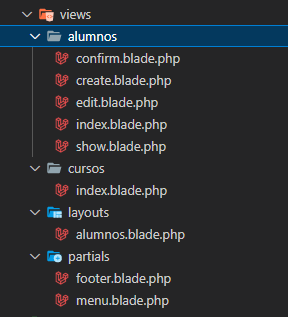

# Layouts

### Konponenteak

Gaur egun, programatzaile gehienek txantiloi bat egitean, konponenteak erabili ohi dute. Horrela egiteko, konponente arrunta bat izango balitz erabiliko genuke.

Abididez, sortuko genuke app-layout.blade.php fitxategia html estruktura orokorrarekin, html, head, body, footer etc eta gure slot izango litzateke orriko mamia:

```php
<body>

<header>

<h1>Webgunearen goiburua</h1>

</header>

<main>

{{ $slot }}

</main>

<footer>

<p>Webgunearen oinarria</p>

</footer>

</body>
```

Eta gure home-en adibidez, erabiliko genuke hori koponentea orain arte ikusi dugun moduan:

```html
<x-app-layout>

<h1 class="text-3xl font-bold underline px-20">

Hau da nire blog-aren lehenengo orria. Ongi etorri!!

</h1>

Eta hemen kodea jarraitzen du

</x-app-layout>
```

### Layouts

Layouts, gure bisten eraikuntza elkartzeko interegarriak izan daitezke.

Alde batetik @include erabili dezakegu, banatuta dagoen kodea erabili ahal izateko:

```php
@include('footer')

//Hala, view-en zuzenean gordetako elementu bat sartuko dugu, php edo luzapena duena blade.php
```

Helper asset()

Asset helperrak gure fitxategiaren url absolutua ematen digu, modu honetan saiestuko dugu fitxategiaren ruta aldatzea segun eta zein URL-a dugun.

```php
<link href="{{ asset('css/style.css') }}" rel="stylesheet">
```

Baina benetan erabilgarriena Layouts-ak erabiltzea izango litzateke. Gure txantiloia hainbat fitxategietan banandu beharrean, txantiloi bat sortu dezakegu gure lekuaren estruktura guztia duena. Adibidez app.blade.php izena jarri diezaiokegu eta barruan gure diseinuaren kode guztia sartu. Normalean hauek layout azpikarpetan gordetzen dira.

Txantiloiaren barruan @yield direktiba erabiliz atalak (secciones) adierazi ditzakegu, argumentu bezala atalaren izena pasatuz, eta gero txantiloi bakoitzea atalari dagokion kodea sartuko genuke:

```php
<main role="main" class="container">

@yield('content')

</main>
```

Layouts-ak edozein izen izan ditzakete, baina beti .blade.php luzapena izan behar dute.

@yield direktiban hainbat modutan erabili daitezke, adibidez gure webgunearen titulua personalizatzeko.

```html
<title>@yield('title') - Nireweb.net</title>
```

@yield direktibei ere, lehenetsiko balio eman diezaiokegu,adibidez:

```html
<title> @yield('title', 'Lehenetsiko titulua')</title>
```

@section erabiliko dugu atalak zehazteko eta @yield direktiba, atal horiek gure txantiloian (gure layout-ean) kokatzeko.

Beraz, atalek @section direktiba erabiliko dute, argumentu moduan dagokion izena pasatuko diogu:

```php
@section('title') Usuario {{ $id }} @endsection

@section('content')

<!-- Contenido de la sección -->

@endsection
```

Aurreko adibidean, title-ren kasuan, lerro bakarra denez, izenburua parametro moduan pasatu dezakegu:

```php
@section('title', "Usuario {$id}")
```

### Txantiloi bat luzatzea

Banakako txantiloi bakoitzean, header edo footerra sartu beharrean, Laraveli esango diogu ikuspegia app.blade.php-z luzatu behar duela.

Ez da beharrezkoa fitxategiaren luzapena jartzea, ezta ibilbide osoa jartzea ere ez, Laravelek, lehenespenez, resources/view  bilatuko baitu fitxategia, gure kasuan txantiloia layouts karpeta barruan sartu dugunez, horrela egingo genuke.

```php
@extends('layouts.app')
```

Behin hau eginda, atalak sortuko ditugu:

```php
@section('content')

<!-- Contenido de la sección -->

@endsection
```

### @stack direktiba

@yield() erabiliz gain, @stack direktiba ere erabili dezakegu. Normalean @yield erabiliko dugu edukia behin bakarrik erabiliko dugunean,a dibidez, title-rekin egin dugun moduan. Baina beste kasu batzuetan interesa diezaguke eduki horreri guazak gehitzen joatea, adibidez, css edo js koadea...

```php
@stack('css')
```

Eta horreri edukiak gehitzeko, @push direktiba erabiliko genuke, direktiba hau gure  kodean zehar behin baino gehiagotan erabili dezakegu:

```php
@push('css')

<style> body {background-color: darkcyan}</style>

@endpush

@section('content')

@push('css')

<style> h1 { color: rgb(16, 34, 133)}</style>

@endpush

<h1 class="text-3xl font-bold underline px-20">

Hau da nire blog-aren lehenengo orria. Ongi etorri!!

</h1>
```

### Partials

Layouts erabiltzeaz gain, partials izeneko artxiboak ere badaude; artxibo horiek kode-segmentu txikiak dira, eta normalean sistemaren zati jakin batzuetan erabiltzen dira, menuak, footerrak etab.

Ondoko adibidea jarraituz, alumnos.blade.php txatiloain deiak hurrengo kodean agertzen den moduan egin beharko genituzke:

```php
<body>

@include('partials.menu')

@yield('content')

@include('partials.footer')
</body>
```


