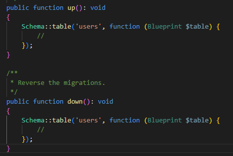

# Migrazioak

Zer dira migrazioak? Migrazioak Laravel-ek datu-basearen bertsio-kontrola eramateko erabiltzen duen sistema dira. Horri esker, datu-basean egindako aldaketak dokumentatuta eta kontrolatuta geratzen dira, beste pertsonek ere exekutatu ahal izateko edo arazoren bat egonez gero, aurreko egoerara itzultzeko aukera izateko.

Migrazioak datu basean ditugun taulak kudeatzeko ere erabili ditzakegu, hau da, taula berriak sortzeko, taularen eremuren bat aldatu ahal izateko edota ezabatu ahal izateko.

Migrazioak database>migrations karpetan gordeko dira. Migrazio bakoitzak php baten egongo da, eta horretan ikusi dezakegunez Migration klase bat dago 2 metodo dituenak: up() eta down(). Migrazioa exekutatzerakoan up() metodoari deituko dio, eta reset edo refresh edo horrelakoetan, down() metodoari deituko zaio.

Migrazioekin lan egiteko, artisanek baditu hainbat metodo: make:migration, migrate:refresh, migrate:reset eta migrate:rollback

make:migration

Migrazio berri bat sortzeko erabiltzen da.

```bash
php artisan make:migration create_pupils_taula

php artisan migrate
```

Sortuta dauden migrazio guztiak exekutatzen ditu.

Laravel-ek bakarrik exekutatu gabe dauden migrazioak exekutatzen ditu beti, automatikoki. Ez du berriro exekutatuko jada exekutatu direnak (migrations taulan apuntatuta daudelako).

```bash
php artisan migrate
```

migrate:rollback

Azken batch edo "lote"-an exekutatu diren migrazioak desegiten ditu.

Hau da, azken exekuzioan egin ziren migrazio guztiak atzera botatzen ditu (down() exekutatuz).

Batch-a migrations taulako batch eremuan ikus daiteke.

```bash
php artisan migrate:rollback
```

migrate:reset

Migrazio denak desegiten ditu (down() deituz), ez bakarrik azken lotea.

```bash
php artisan migrate:reset
```

migrate:refresh

Lehenik reset egingo du (down() metodo guztiak), eta ondoren berriro exekutatuko ditu migrazio guztiak (up() metodo guztiak). Hau oso erabilgarria da garapenean datu-basea "garbi" izateko.

```bash
php artisan migrate:refresh
```

migrate:fresh

Taula guztiak ezabatzen ditu FIZIKOKI, eta gero up() metodo guztiak exekutatzen ditu.

Ez du down() metodoa erabiltzen, eta horregatik arriskutsuagoa da.

### Taula berri bat sortu migrazio bat erabiliz

Taula berri bat sortzeko, migrazio berri bat sortuko genuke, hurrengo instrukzioa erabiliz:

```bash
php artisan make:migration create_posts_table
```

Behin fitxategia sortuta dugunean, klase berri bat sortu digutela ikusi dezakegu, horren ostean up() eta down() metodoak aldatuko ditugu:

```php
public function up(): void

{

Schema::create('posts', function (Blueprint $table) {

$table->id();

$table->string('title');

$table->text('content');

$table->timestamps();

});

}
```

/\*\*

\* Reverse the migrations.

\*/

```php
public function down(): void

{

Schema::dropIfExists('posts');

}
```

### Zelan egin taula baten eremu aldaketa taulak datuak izanda?

Taula baten eremuak aldatzeko, migrazioa sortuko genuke ere. Hau horrela egingo genuke datu basean datuak izanez gero, ez izatekotan zuzenean create migrazioa aldatuko genuke eta refresh batekin exekutatu guztiak.

Adibidez, taula baten eremu berri bat sartzeko, migrazio berri bat sortu beharko genuke. Lehen esan dugun moduan, migrazioaren izena edozein izan daiteke, baina "konbentzioz" horrela idatziko genuke:

```bash
php artisan make:migration add_avatar_to_users_table
```



Sortuko zaigu migrazio dokumentu bat aurreko metodoekin, beraz hemen eremua gehituko dugu create kasuan moduan. Taulan datuak egongo direnez, eremua sortzerakoan jarri behar dugu null izan daitekeela, akatsarik ez emateko. Hau up() metodoan idatziko dugu.

```php
$table->string('avatar')->nullable();
```

down() metodoan ere zutabea ezabatu beharko dugu-

```php
$table->dropColumn('avatar');
```

Migrazio hau exekutatzerakoan, avatar zutabea gehitu du, baina taularen bukaeran. Horrela nahi ez izatekotan, rollback egingo dugu eta gero aldaketa migrazioan

```bash
php artisan migrate
```

Demagun email eremuaren ostean jarri nahi dugula:

```php
$table->string('avatar')->nullable()->after('email');
```

Dokumentazio ofiziala hurrengo esteka honetan duzue: <https://laravel.com/docs/12.x/migrations>

Hurrengoa: Eloquent
