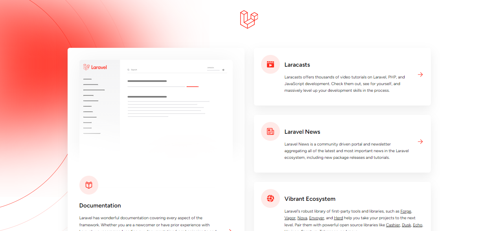

# Instalazioa

Ikasturte honetan Laravel 13 erabiliko dugu. Laravel aplikazio bat sortzeko, PHP eta Composer behar dira. Aplikazioaren frontend-eko baliabideak (CSS eta JavaScript) lantzeko, Node.js eta npm ere erabiliko ditugu.

Laravel instalatzeko modu errazena Laravel Installer erabiltzea da. Beste aukera gisa, Composer-en bidez sor dezakezu proiektua.

Dokumentazio ofiziala: <https://laravel.com/docs/13.x/installation>

## Aurrebaldintzak

- **PHP 8.3 edo berriagoa**, eta Laravel-ek behar dituen PHP luzapenak.
- **Composer 2**, PHP mendekotasunak kudeatzeko.
- **Node.js eta npm**, frontend-eko baliabideak instalatu eta konpilatzeko.
- **Datu-base bat**: SQLite aukera lehenetsia da; MySQL ere erabil dezakezu.
- **Git**, kode-biltegi batekin lan egin edo proiektu bat klonatu behar baduzu. Ez da beharrezkoa Laravel proiektu berri bat sortzeko.

Instalazioak egiaztatzeko, ireki terminal bat eta exekutatu:

```bash
php -v
composer --version
node -v
npm -v
```

Komando batek ez badu funtzionatzen, instalatu dagokion tresna eta egiaztatu terminalaren `PATH` aldagaian dagoela. Composer edo Node.js instalatzeko argibideak [Composer](../Más/composer.md) eta [Node.js](../Más/nodejs.md) ataletan daude. PHPren luzapenak egiaztatzeko, erabili `php -m`; Composerrek `zip` luzapenari buruzko errorea ematen badu, aktibatu luzapen hori zure PHP konfigurazioan.

## Laravel Installer erabiliz (gomendatua)

Instalatu Laravel Installer Composer bidez:

```bash
composer global require laravel/installer
```

Windows-en `laravel` komandoa ezagutzen ez badu, begiratu Composer-en komando globalen direktorioa:

```bash
composer global config bin-dir --absolute
```

Gehitu komandoak erakutsitako direktorioa erabiltzailearen `PATH` ingurune-aldagaian, ireki terminal berri bat eta sortu proiektua:

```bash
laravel new nire-proiektua
cd nire-proiektua
```

Instalatzaileak hainbat aukera galdetuko dizkizu, hala nola datu-basea eta hasierako egitura. Aukerak ez badituzu ezagutzen, erabili proposatutako lehenetsiak; gero ere alda daitezke. Autentifikazioa behar baduzu, hautatu instalatzaileak eskaintzen duen hasierako egitura.

## Beste aukera bat: Composer bidez

Laravel Installer erabili nahi ez baduzu, sortu proiektua Composer-ekin:

```bash
composer create-project laravel/laravel nire-proiektua
cd nire-proiektua
```

## Datu-basea konfiguratzea

Proiektu berriek SQLite erabil dezakete lehenespenez. MySQL erabili nahi baduzu, sortu datu-basea lehenik eta egokitu proiektuaren erroko `.env` fitxategiko balioak:

```ini
DB_CONNECTION=mysql
DB_HOST=127.0.0.1
DB_PORT=3306
DB_DATABASE=laravel
DB_USERNAME=root
DB_PASSWORD=
```

Erabili zure MySQL zerbitzariari dagozkion datuak, eta ziurtatu zerbitzaria martxan dagoela. Ondoren, exekutatu migrazioak:

```bash
php artisan migrate
```

SQLite erabiltzen baduzu, egiaztatu `.env` fitxategian `DB_CONNECTION=sqlite` dagoela. Beharrezkoa bada, sortu `database/database.sqlite` fitxategia proiektuaren barruan eta exekutatu migrazioak.

## Aplikazioa abiaraztea

Frontend-eko paketeak instalatzeko, proiektuaren erro-direktorioan:

```bash
npm install
```

Ireki terminal bat frontend-a garapen-moduan exekutatzeko:

```bash
npm run dev
```

Ireki beste terminal bat, sartu proiektuaren direktoriora eta abiarazi Laravel:

```bash
php artisan serve
```

Terminalean erakutsitako helbidea ireki nabigatzailean; normalean <http://127.0.0.1:8000> izango da. Garapeneko zerbitzaria gelditzeko, sakatu `Ctrl+C`.

Frontend-a garapen zerbitzaririk gabe konpilatu nahi baduzu, erabili `npm run build`.



## Ohiko arazoak

- **Komando bat ez da aurkitzen:** berrikusi tresna instalatuta dagoela eta terminalaren `PATH` aldagaian dagoela; ondoren, ireki terminal berri bat.
- **PHP luzapenen errorea:** egiaztatu `php -m` komandoaren emaitza eta aktibatu falta den luzapena erabiltzen ari zaren PHP konfigurazioan.
- **Datu-basearekin konektatzeko errorea:** egiaztatu zerbitzaria martxan dagoela, `.env` fitxategiko datuak zuzenak direla eta MySQL erabiltzen baduzu datu-basea sortuta dagoela.
- **Baimen-errorea:** Laravel-ek idazteko baimena behar du `storage` eta `bootstrap/cache` direktorioetan. Eman baimenak zure erabiltzaileari; ez eman baimen zabalik direktorio horiei.

Laravel aplikazioa garapeneko zerbitzariarekin bakarrik probatu behar da. Benetako zerbitzarian argitaratzeko, jarraitu Laravel-en [hedapen-gida](https://laravel.com/docs/13.x/deployment).
