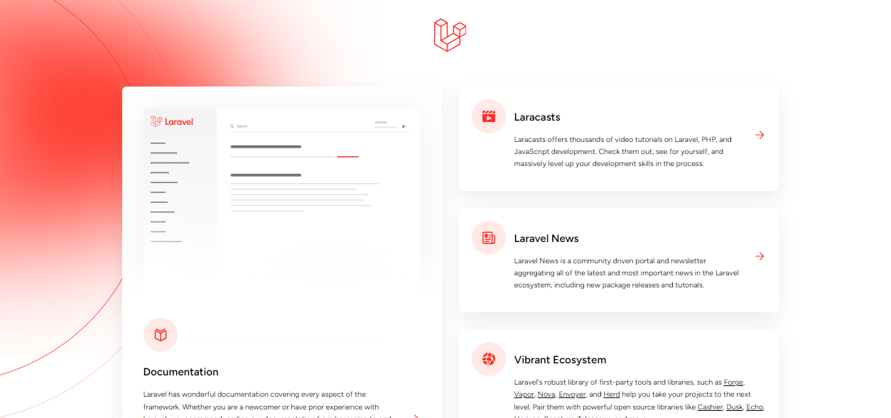
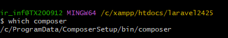

# Instalazioa

Laravelek, Windows edo Mac-en instalatzeko hainbat modu eskaintzen ditu. Laravel instalatzeko modurik onena eta errazena Composer da. Composer php-rako mendekotasunen administratzailea da, eta bere web-zerbitzarian instala dezake.

### Laravelekin lan egiteko aurrebaldintzak

- Ikasturte honetan Laravel 12-rekin lan egingo dugu, eta horrek  PHP 8.2 - 8.4 edo goragokoa eskatzen du, PHPren PDO luzapena, datu-basearekin konektatzeko.
- MySQL (edo datu-baseen beste iturri batzuk, SQLite t ere erabil dezakezu
- Composer instalatuta izatea.
- Node.js (lagungarri baina ez beharrezkoa)
- Git (Laravel 11-tik aurrera beharrezkoa)

Zure ordenagailuan software horiek instalatuta dituzun egiaztatzeko, komando pare bat bota behar duzu kontsolaren bidez.

- PHP instalaturik dugun jakiteko. Komando hauetariko  bat erabili dezakezu:

C:\xampp\php> .\php -v

- PHP instalaturik dugun jakiteko ere php gfitxategi baten hurrengo funtzioa idatzi dezakegu:

```php
<?php phpinfo(); ?>
```

## Instalazioa

- Webgune ofiziala: <https://laravel.com/docs/12.x/installation>

1.- Laraveleko instalatzailearen bidez

Laravelen instalatzailea Composer-ekin deskarga dezakezu, komando hau erabiliz:

```bash
composer global require laravel/installer
```

Ziurtatu ~/.composer/vendor/bin direktorioko ibilbidea zure PATHen artean dagoela, horrela zure sistemak behar bezala Laravelen instalatzailea aurkitu eta exekutatu ahal izango du. Direktorio hori aldatu egin daiteke sistema eragilearen edo erabiltzen ari zaren banaketaren arabera.

Gero, laravel new komandoa erabiliz, Laravelen azken bertsioaren kopia sor dezakezu. Adibidez, nombreProyectoizeneko proiektua sortuko dugu:

laravel new nombreProyecto-app

Proiektu berrirako nahi duzun izena aukera dezakezu.

Kasu honetan hainbat galdera egingo dizkigu, adibidez ia Breeze edo Jetstream nahi badugu. Momentuz ezetz esango genioke.

Frogak egiteko framework bat, ezetz momentuz ere

Git repository, horreri adibidez yes esango genioke.

Azkenean ere zein datu basearekin gure dugu sortu esango diogu.

2.- Composer bidez (direktorioa nombreProyecto)

Laravel Composer-ekin ere instala dezakezu, komando hau erabiliz:

```bash
composer create-project laravel/laravel izenaProiektua
```

--prefer-distint --prefer-install: Pakete bat deskargatu behar da batzuetan: source y dist.

Composerrek dist erabiltzen du lehenespenez. Pasatzen bada --prefer-install=source (edo --prefer-source), Composer iturritik instalatuko da, bat egotekotan.

Hori erabilgarria da proiektu bateko akats bat zuzendu eta mendekotasunaren tokiko git klon bat zuzenean lortu nahi baduzu. Composerrek paketeen garapen-bertsioetarako iturria automatikoki erabiltzen duen portaera heredatua lortzeko, erabili --prefer-install=auto. Ikus, halaber, config.preferred-install. Bandera hori pasatzeak konfigurazio-balioa baliogabetuko du.

```bash
composer create-project --prefer-dist laravel/laravel izenaProiektua
```

3. -Laraveleko instalazioa Laravel Breezerekin

Laravel Breezek abiapuntu bikaina eta erraza eskaintzen dizu Laravelen aplikazioak autentikatzeko. Breeze erabiltzen hasteko, lehenbizi Laravelen proiektu berri bat sortu behar duzu:

Gero, zure proiektuaren erro-direktorioaren barruan, instalatu Breeze garapen-mendekotasun gisa:

```bash
composer require laravel/breeze --dev
```

Orain, erabili Artisanen breeze:install komandoa Breezek kautotze- eta ikuste-kontrolatzaile guztiak (Blade eta Tailwinden diseinatuak) kopiatu ditzan zure proiektuan:

```bash
php artisan breeze:install

php artisan migrate
```

Eta, azkenik, ondorengo komandoa exekutatzen du Breezeko interfazeko asset guztiak konpilatzeko:

```bash
npm install && npm run dev
```

Arazoak izanez gero, hurrengo estekan sartu:  <https://www.cursosgis.com/como-instalar-node-js-y-npm-en-4-pasos/>

Gogoratu Breezeko kontrolatzaileak eta ikuspegiak pertsonaliza ditzakezula zure aplikazioaren beharretara egokitzeko.

4.-Git bidezko instalazioa

GitHub kodean edo Laravel beste proiektu batean hasiko gara. Hemen fase guztiak eskuz egin beharrekoak dira:

- Deskarga

```bash
git clone https://github.com/laravel/laravel.git nombreProyecto

cd nombreProyecto
```

- Mendekotasun instalazioak

```bash
composer install
```

- Sortu ingurune-fitxategia adibidetik abiatuta:

```bash
cp .env.example .env
```

- Zifratze-gakoa sortzea (.env ikusi).

```bash
php artisan key:generate
```

OHARRA

Laravel proiektua abian jartzea, zerbitzari integratuarekin

- artisan modu orokorrean erabiltzen da. Adibidez, klase guztiak komando horrekin sortu behar dira.
- Exekutatuz zerbitzaririk gabe gara dezakegu:

```bash
php artisan serve              # para iniciar el servicio
```

ctrl+C                         # para cerrar

Gure zerbitzarirako iragarritako URL hori zure nabigatzaile gogokoenarekin irekiz, Laravelekin instalatu berri den aplikazio baten ongietorriko orria ikusi beharko zenuke.



KONTUZ HONEKIN!

Batzutan, segun eta zein terminal erabiltzen dugun, izan daiteke composer-en PATH-a ondo konfiguratuta ez egotea, hori gertatzekotan, terminalari adieraziko diogu PATH hori non dagoen.

Visual Studion gertatzekotan, Settings zabaldu eta settings.json fitxategian hurrengo hau idatziko dugu.

"terminal.integrated.env.windows": {

"PATH": "C:/ProgramData/ComposerSetup/bin/composer;${env:PATH}"

}

Non instalatuta dagoen jakiteko, beste terminal baten galdetuko dugu, adibidez git bash-en:

which composer



Visual Studio-ren terminala  erabiltzean, php-ini fitxategian ;extension=zip aktibatu behar dugu ; kentzen.

extension=zip

Baliteke Laravelen salbuespen bat jasotzea sartzeko behar adina pribilegio ez duzunean, normalean storagedirektorioan Laravelen log-fitxategia sortu ezin denean. Hori konpontzeko, pribilegioak doitu ditzakezu; adibidez, Linux-en chmodkomandoa erabil dezakezu erabiltzaileen irakurketa- eta idazketa-pribilegioak emateko.

Zure proiektua duen direktoriotik, hauek egin ditzakezu:

```bash
sudo chmod -R o=rwx storage
```
