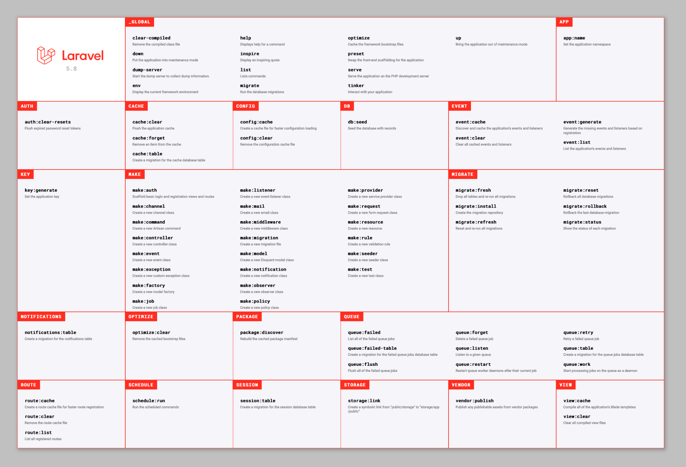

# Artisan

Laravelekin lan egitea izugarri erraztuko dizun komando-lerroko interfazea da Artisan.

Terminalaren bidez, komando-lerro sinple batzuk exekutatu ahal izango dituzu, zure web aplikazioaren hainbat alderdi kudeatzeko.

Hona hemen adibide erraz batzuk, artisanek eskaintzen dizkizun aukerak hobeto uler ditzazun:

make motako komandoekin, entitate edo utilitate ugari sor ditzakegu automatikoki, koderik idatzi beharrik gabe. Ereduak, kontrolatzaileak, ikuspegiak, migrazioak, middlewareak, jakinarazpenak… sor ditzakegu.

Artisanekin, gainera, zure proiektuko cachea garbitu, localhost bat egin edo autentifikazio-sistema bat instalatu dezakezu.

Artisauen dokumentazio ofiziala:

<https://laravel.com/docs/12.x/artisan>

Laravelen beste alderdi garrantzitsu bat da Artisan CLI edo komando-lerroa da. Horrekin, Laravelen edozein zati sor edo alda dezakezu komando-lerrotik, karpeta eta fitxategietan nabigatu beharrik gabe.

Artisanekin, zure datu-basearekin zuzenean jardun dezakezu zure komando-lerrotik, Laravel Tinker erabiliz – dena datu-baseko bezeroa instalatu gabe.

Adibidez, Artisanek dituen komando guztiak ikusi ahal izateko, artisanen list erabili dezakezu:

```bash
php artisan list
```



Artisan instalatuta dagoen jakiteko:

```bash
php artisan
```
