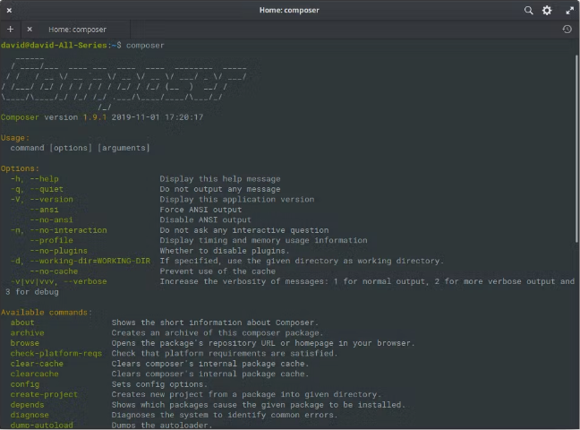

# CompoSer

Web ofiziala: <https://getcomposer.org/>

Composer PHPrako pakete-kudeatzailea da, edo "manejador de dependencias", eta bulegoak eta liburutegiak administratzeko, deskargatzeko eta instalatzeko estandar bat ematen du.

Compeserrek lagunduko gaitu paketeak eta konponenteak instalatzera, proiektu berrian sortzera, sergurtasun bertsioak sortzera etab

Mendekotasun bakoitza eskuz deskargatu beharrean, Composerrek automatikoki egiten du hori.


Instalatu aurretik, konprobatuko dugu ia instalatuta dugun jada, horretarako gure terminalean sartu eta hurrengoa idatziko dugu:

```bash
composer -V
```

### Composer instalazioa

Windowsen bazaude, deskargatu Composer instaladorea [esteka honetatik](https://getcomposer.org/download/).

Composer exekutatzeko, terminalean composer komandoa idatzi eta Enter sakatu besterik ez duzu egin behar. Aurrelo irudian ikusten den moduko zeozer topatuko genuke.

### Composer komandoak eta argudioak



Irudian ikus dezakezunez, Composerrek hainbat zeregin egiteko aukera ematen diguten komando eta argudioen zerrenda du. Komando garrantzitsuenak zehaztu eta deskribatuko ditugu, banan-banan:

$ composer init

Komando hau exekutatzean composer.json artxiboa sortzeko balioko duen informazio jakin bat eskatuko du.

$ composer install

Komando horrek composer.json fitxategia prozesatu eta mendekotasunak ebazten ditu; normalean, /vendor izeneko direktorio batean instalatzen ditu, baina beste edozein zehaztu dezakegu.

$ composer update

Zure proiektuko mendekotasunak azken bertsiora eguneratzen ditu, eta composer.lock fitxategia ere eguneratzen du. Hori hainbat modutan egin daiteke, imajinatu mendekotasun jakin bat baino ez duzula eguneratu nahi; horretarako, paketearen izena honela adierazi behar duzu:

$ composer update vendor/package another-vendor/another-package vendor-x/package-x

Horrek zehaztutako gelak bakarrik eguneratuko ditu; pakete jakin bateko gela guztiak eguneratu nahi badituzu, karaktere asko aurrez ditzakezu komodin \* bat erabiliz:

$ composer update vendor-x/\*

Zehaztutako gelak behar ditu komandoak:

$ composer require vendor/package:\*

Search komandoak Packagist-en adierazitako paketea bilatzen du , paketearen izena pasatu besterik ez duzu egin behar.

$ php composer search monolog

Show komandoak erabilgarri dauden paketeak erakusten ditu, eta pakete jakin baten xehetasunak ere ikus ditzakezu. Nahikoa da argumentu bat ematea, horrek izan behar du paketearen izena:

$ php composer show vendor/package

Informazioa zabalduko du: paketearen izena, bertsioak, pakete-mota, iturburu-kodea, iturburu-kodearen zipa, lizentzia, etab.

Adierazitako paketea zein paketeren mende dagoen adierazten du depends komandoak. Require eta requir-dev motako paketeak erakusten ditu

$ php composer depends vendor/package

Gure composer.json artxiboa behar bezala idatzita dagoela eta norbaitek ez duela akatsik izango hura deskargatzean, eta ez duela arazorik izango gelak instalatzerakoan konprobatzeko, validate komandoa erabili dezakegu.

$ php composer validate

Zure mendekotasunetan aldaketak maiz egiten badituzu, eta biltegiaren iturburu-kodearen bidez instalatu badituzu, status komandoak aukera ematen dizu horietako batean aldaketarik egin duzun egiaztatzeko, eta git status-ak zein fitxategi aldatu ditugun adierazten badigu, komando horrek berdin funtzionatzen du:

$ php composer status -v

-v aukera gehitzen baldin badugu, aldaketei buruzko informazio zehatzago emango liguke.

# Resultado de ejecutar composer status -v

You have changes in the following dependencies:

vendor/seld/jsonlint:

M README.mdown

Self-update komandoak Composer bera eguneratzen du bertsio berrienean; kontsolan hurrengo pausua bakarrik idaztearekin nahiko duzu:

$ php composer self-update

Config komandoak Composer-en hainbat aukera edita ditzakezu, bai proiektuaren artxibo lokalean, bai artxibo globalean.

$ php composer config --list

Create-project komandoak proiektu berri bat sortzen du, dagokion saltzailea eta packagea parametro gisa pasatu behar dira. Gauza bera da proiektua deskargatzea eta, ondoren, composer.json fitxategia exekutatzea, bertan datorrena; hurrengo adibideak laravel-proiektu bat sortzen du.

$ php composer create-project laravel/laravel mi-proyecto

Orain, zure autoloader fitxategia eguneratu behar baduzu klase berriak dituzulako, dump-autoload komandoarekin egin dezakezu; install edo update exekutatzea bezalakoa da, baina abantaila bategaz, proiektuko  klase guztiak fitxategi guztiekin sortuko dela, honela:

$ php composer dump-autoload --optimize

Run-script komandoak pakete batek definitutako script-etako bat eskuz exekutatzeko aukera ematen du.

$ php composer run-script nombre-script --no-dev

Garatzeko modua desaktibatzeko --no-dev gehitu dugu.

Help komandoa erabiltzen du eskatutako komandoari buruzko informazioa ikusteko.

$ php composer help install

Remove komandoak erabiltzen ez dugun mendekotasun bat kentzeko balio du, honela erabiltzen da:

$ php composer remove vendor/package
