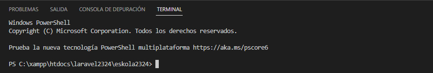

# GitBAsh

Composerrek esan bezala, "linea de comandos"-etik egiten du  lan, beraz horretarako Gitbash, Visual Studioren terminala edo Windows-en kontsola erabili dezakegu,

### GitBash

- [GitBash zelan instalatu](https://dev.to/mailingdelgadomedina/como-instalar-gitbash-en-windows-10-4o0e)
- [Zelan aldatu GitBash-en ruta?](https://www.codigonexo.com/blog/programacion/entornos-de-trabajo/cambiar-ruta-de-inicio-git-bash/)

GitBash-ekin lan egiteko baditugu hainbat komando, [esteka honetan](https://medium.com/@ergalez/comandos-b%C3%A1sicos-en-la-terminal-de-git-bash-en-windows-cbb43c9cea82) badaude hainbat.

### Visual Studio Terminala

Ver > Terminal (Ctrl + ñ) sartu zaitezke

### Windows kontsola

cmd
