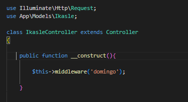

# Middleware

### Zer da Middleware bat?

Laraveleko middleware bat ibilbideetako filtro gisa funtzionatzen duen klase bat da, hau da, gure ibilbideari edo ibilbide-taldeari middelware bat gehitu diezaiokegu, adibidez, erabiltzaile bat gure aplikazioan autentifikatuta ez badago haietara sartzea murrizteko.

Laraveleko middleware ezagunena eta erabiliena lehenespenez sortutakoetako bat da, middleware authenticate izenekoa, erabiltzaile bat gure aplikazioan logeatuta dagoen kontrolatzen duena. Gure ibilbideetan kautotze-middlewarea gehitzen badugu eta middlewareak egiaztatzen badu erabiltzailea ez dagoela egiaztatuta, lehenespenez login-biderantz birbideratuko luke.

Hau da, gure rutetan jartzen diogun baldintza bat da, beraz eskaera egiterako orduan, gauza bat edo bestea egingo du.

Laravelek baditu lehentsiko middleware batzuk, hauek: app>http>Middleware karpetan gordetzen ditu eta baita kernel.php fitxategian.

Adbidez ikusi dezakegu zelan Laravelek baditu erabiltzen dituen bi, Providers > RouteServiceProvider.php-n api eta web, baina guk sortu ditzakegu gute Middleware propioak:

### Middleware sortu:

Middleware bat sortzeko, artisan erabiliko dugu modu honetan:

```bash
php artisan make:middleware DomingoMiddleware
```

Komando honek, app/Http/Middleware  direktorioan klase berri bat jarriko du. Gure middleware honek zeozer egingo du eguna igandea dela ikusten duenean. Artisanen komando horrek oinarrizko middleware bat sortzen du, eta metodo bakarra izango du, handle() izenekoa.

Metodo honek kontrolatuko du ia ingadea den ala ez, eta izatekotan mezua aterako du, horretarako hurrengo kodea sartuko dugu gure metedoan:

if(date('w')==='0'){

echo "Igandea da!";

}else{

echo "Gaur ez da igandea";

}

```php
return $next($request); // Honek esan nahi du aurrera jarraituko duela
```

Adibide honetan mezua aterako dugu echo baten bidez, dakigunez hau ez da horrela egiten, adibide hau egiteko bakarrik egingo dugu, mezu guztiak bisten bidez atera beharko genituzkelako, eta bestetik Middleware-ak eginkizunak normalean erabiltzailea leku batera edo bestera eramateko erabili oi da.

### Middlewarea erregistratu

Orain, sisteman nola exekutatzen den ikusteko, middlewarea erregistratuko dugu. Modu globalean erregistratzen hasiko gara, gure aplikazioak aintzat hartzen dituen eskaera guztietan gauzatu dadin.

Oso erraza da, Kernel.php artxibotik (app/Http/Kernel.php bidean dago) egiten da.

Modu globat baten erregistratzeko

Modu global batean exekutatu daitezkeen Middleware guztiak dauden Kerneko klaseko propietatean idatziko dugu:

```php
protected $middleware = [
```

.....

\App\Http\Middleware\DomingoMiddleware::class,

];

Ikusten dugunez, exekutatuko diren middleware array batean sartu dugu gure, kasu honetan azkeneko elementua izango da, honek esan nahi du lehentasun gutxien duen middlewarea izango dela, lehentasuna handitu nahi izanez gero, arrayan lehenago kokatu beharko genuke.

Middlewarea modu globalean erregistratu ondoren, aplikazioaren edozein orritan sar zaitezke, eta middlewarearen irteera ikusi beharko litzateke, igandea den ala ez jakinaraziz.

Ibilibide zehatz baterako edo kontroladore bakar baten erregistratzeko

Urrats hori egiteko hainbat modu daude, bai bide-sistematik bai kontrolatzaileetatik, baina beti hasi behar dugu Kernel.php fitxategian gure middlewareari izen bat ematen. Han, Kernel klasean, $routeMiddleware izeneko bigarren propietate bat dago, non array bat baitugu ibilbideetan erabili nahi ditugun middlewarrekin.

Arrayaren elementu bakoitzak indize bat du, eta indize hori izango da middlewareari ematen diogun izena, bideratze-sistematik hari erreferentzia egiteko.

```php
protected $routeMiddleware = [
```

................

'domingo' => \App\Http\Middleware\DomingoMiddleware::class,

];

Orain, middlewarea, aurreko arrayan emandako indizearen bidez exekuta dezakegu.

Hiru aukera daude horretarako:

1. Bideratze-sistematik, bidea definitzean, erabili nahi dugun middleware bat adieraz dezakegu. Hori ibilbideen erregistrotik egin behar dugu, routes/web.php fitxategi bideratzailean, ondoren ikus dezakezun sintaxiaren bidez.

```php
Route::get('/test', ['middleware' => 'domingo', function(){

return 'Middleware ibilbidea frogatzen';

}]);
```

2. Baita ere, bideratze-sistematik middleware hori exekutatzeko bide-multzo bat sor dezakegu.

```php
Route::group(['middleware' => 'domingo'], function(){

Route::get('/probando/ruta', function(){

//código a ejecutar cuando se produzca esa ruta y el verbo

return 'get';

});

Route::post('/probando/ruta', function(){

//código a ejecutar cuando se produzca esa ruta y el verbo POST

return 'post';

});
```

3. Kontrolatzaile batetik middleware bati ere dei diezaiokegu. Eraikitzailetik egin dezakegu; beraz, middleware horrek kontrolatzailearen barruko ekintza guztiei eragingo die.

```php
public function __construct(){

$this->middleware('domingo');

}
```



Kasu honetan ez dugu bide-sistematik middlewarea aipatu behar; kontrolatzailearen eraikitzailetik soilik aipatuko dugu, bertan deklaratutako edozein ekintzatan exekutatzeko.

### Middleware bat hurrengoarekin lotu:

Laraveleko middlewareen filosofiaren arabera, eskaera bakoitzerako katean, bata bestearen atzetik exekutatzen diren batzuk egon daitezke. Horregatik ziurtatu behar dugu kateatze hori gerta daitekeela. Egia esan, lan hori, dagoeneko, artisanekin sortzen den middlewarean egiten da, eta, beraz, ez gara gu kezkatu behar. Hala ere, kate-prozesamendu hori non lortzen den ikustea nahi dugu.

Ikus dezagun automatikoki sortutako middlewarearen handle() metodoa:

```php
public function handle($request, Closure $next){

return $next($request);

}
```

Ikus daitekeenez, metodo honetan itzultzean $next()-rako deia itzultzen da, $request parametrotzat hartuta. Dei horri esker, middleware globalen zerrendan hurrengo middlewarea exekutatu daiteke, eta, gainera, request osoa hurrengo middlewarera bidali, iragazten jarrai dezan.

Berez, ez dugu ezer eskuz egin behar, Laravelek handle metodoan ematen baitizkio $request eta $next parametroa. Gainera, Laravelek badaki middleware hori zerrendako azkena den ala ez, eta kasu horretan ez luke beste kateamendurik egon behar.

Lehenespen gisa agertzen den return hori uztea besterik ez litzateke izango gure lana, denak funtzionatzen jarrai dezan.

<https://laravel.com/docs/12.x/middleware#defining-middleware>
