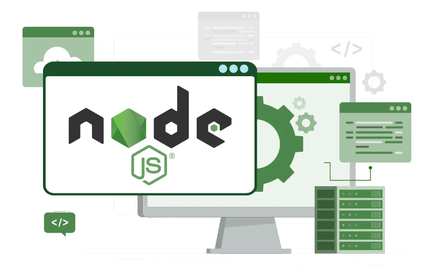

# Node.JS

Web ofiziala: <https://nodejs.org/en/>

Berez Node.js ez zen derrigorrezkoa izango Laravel instalatzeko,baina hoenk baditu hainbat tresna lagungarriak izango zaizkigunak, adibidez vite eta npm.

Node.js instalatzerakoan npm ere instalatuko zaigu.

Konprobatzeko instalatuta dugu ala ez: node -v
