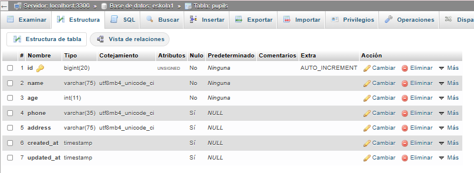

# BALIDAZIOAK

### Balidazioak

Laravelek baditu txertaturik balidazioetarako balio zaizkigun metodo batzuk. Hauek balidazioak datu basean datu bat sartu baino lehen egingo ditugu.

Ezer baino lehen, begiratuko dugu gure datu basean zeintzuk datu dira derrigorrezkoak, zeintzuk dira datu horien mota etab.

1. Akatsak store() metodoaren barruan kontrolatuko ditugu. Formularioaren datu-guztiak jasotzen dituen Request objektua erabiltzen dugu store() metodoko parametro gisa. Ondoren, validate() metodoari ematen diogu array bat, non formularioaren eremuak eta horien balidazio-erregelak zehazten diren.

Laravelek adierazi egiten du, momentu baten balidazioa betetzen ez baldin bada, ez da hurrengo kode lerrora pasatuko eta akatsa emango digu. Aldiz, balidazio guztiak ondo daudenean aurrera jarraituko du.

Gure kasuan, store() metodoan idatziko dugu, gure datu guztiak balidatuko ditugu:

$validated = $request->validate([

'name' => 'required|string|max:75',

'age' => 'required|integer|min:0',

'phone' => 'required|string|max:20',

'address' => 'required|string|max:75',

]);

Pupil::create($validated);

Akatsak mezuetan adierazi

2. Orain, gure inprimakiak ikusiko ditugu. Hor inprimatuko ditugu mezuak formularioko eremuetan, gure kontrolatzaileetan definitzen ditugun baliozkotze-akatsak daudenean.

3. Inprimakiak baliozkotzen hasi aurretik, css kodea erantsiko diegu gure ikuspegi guztiei, errore-mezuei estiloa emateko.

p { color: red; }

Inprimakia ikasleen ikuspegian (bistan) baliozkotzea

4. create.blade.php bistan sortuko ditugu balidazio guztiak.

Input elementuaren azpiko Izen-deiturak eremuan, eremu honetako baliozkotze-kodea gehitzen dugu Bladek eskaintzen digun zuzentarauarekin. @error aukerak eremu honi dagokion errore-mezua inprimatzeko aukera ematen digu.

@error('name')

{{ $message }}

@enderror

5. Gure input-ari gehituko diogu old() metodoa, blade-ko direktiba bat dena. Honegaz lortuko dugu balidazioa egin baino lehen sartutako datua mantentzea.

<input type="text" name="name" placeholder="Izena" value="{{ old('name') }}">

6. Gauza berdina adina elementaun egingo dugu:

<label>Adina:</label>

<input type="text" name="age" placeholder="Adina" value="{{ old('age') }}">

@error('age')

{{ $message }}
 

@enderror

7. Sartutako telefonoa eta helbidea ere mantenduko ditugu:

<label>Telefonoa:</label>

<input type="text" name="phone" placeholder="Telefonoa" value="{{ old('phone') }}">

<label>Helbidea:</label>

<input type="text" name="address" placeholder="Helbidea" value="{{ old('address') }}">

8.  Zer gertatzen da, balidazioa editatzerakoan egiten baldin badugu? Kasu horretan, formularioara sartzen garen lehenengo aldian, datu baseko datua atera nahi dugu, eta akatsa egotekoran old metodoan bueltatzen diguna, hori egiteko, old metodoari bigarren parametro bat sartuko diogu:

<label>Telefonoa:</label>

<input type="text" name="phone" placeholder="Telefonoa" value="{{ old('phone', $pupil->phone) }}">

Ikusten dugunez, mezuak ingeleraz aterako dira, hori aldatu nahi izatekotan, hizkuntza aldatu beharko dugu.

9. Badugu beste modu bat akats guztiak hasieratik erakusteko:

@if ($errors->any())

Errors:

<ul>

@foreach ($errors->all() as $error)

<li>{{ $error }}</li>

@endforeach

</ul>

@endif

Form Request

Gure aplikatiboan balidazio asko egiten baldin baditugu, gure kodea asko zikindu daiteke, horretarako Form request erabili dezakegu, honek esan nahi du gure balidazio kodea fitxategi berri baten jarriko ditugula.

Terminala zabaltzen dugu eta hurrengo kodea idatziko genuke, kasu honetan Pupil kontroladorean store metodoari egingo dugun balidazioa sartzeko:

php artisan make:request StorePupil

Ikusiko dugu zelan fitxategi berri bat sortu zaigu Http>Request karpetan

Fitxategi honetan klase bat sortu da, StorePupil izenekoa bi metodo dituena. athorize() eta rules() metodoa.

Lehenengo izango litzateke kontrolatzeko ia erabiltzailea baimenak dituen ala ez, baina normalean ez da horrela egiten, policekin egin ohi da, beraz guk honetan true balioa jarriko dugu, hurrengo metodoa exekutatu ahal izateko.

Eta rules() metodoan gure kontroladorean ditugun balidazioak jarriko ditugu:

namespace App\Http\Requests;

use Illuminate\Foundation\Http\FormRequest;

class StorePupilRequest extends FormRequest

{

public function authorize(): bool

{

return true;

}

public function rules(): array

{

return [

'name'    => 'required|string|max:75',

'age'     => 'required|integer|min:0',

'phone'   => 'nullable|string|max:35',

'address' => 'nullable|string|max:75',

];

}

Kontroladorean ordun balidazioak kenduko genituzke, eta gure store() metodoan Request objektuaren instantzia bat izan beharrean, esango diodu StoreRequest objektuaren intantzia izatea.

public function store(StorePupil $request){

Balidazioa idazten dituen mezuak aldatu nahi baditugu, adibidez, euskaratu, message() metodo bat sortuko genuke, hurrengo adibidean ikusten dugun moduan:

public function rules(): array

{

return [

'name'    => 'required|string|max:75',

'age'     => 'required|integer|min:0',

'phone'   => 'nullable|string|max:35',

'address' => 'nullable|string|max:75',

];

}

public function messages(): array

{

return [

'name.required' => 'Izena derrigorrezkoa da.',

'age.required'  => 'Adina derrigorrezkoa da.',

'age.integer'   => 'Adina zenbaki osoa izan behar da.',

// eta horrelakoak…

];

}

Atributuen izenak ere aldatu ditzakegun hemen, horretarako attributes() metodoa erabiliko genuke, baina hobeto daude validation.php fitxategian.

public function attributes(): array

{

return [

'name'    => 'Izena',

'age'     => 'Adina',

'phone'   => 'Telefonoa',

'address' => 'Helbidea',

];

}

Laravelen balidazio guztiak hurrengo estekan izango dituzue: <https://laravel.com/docs/12.x/validation#available-validation-rules>
