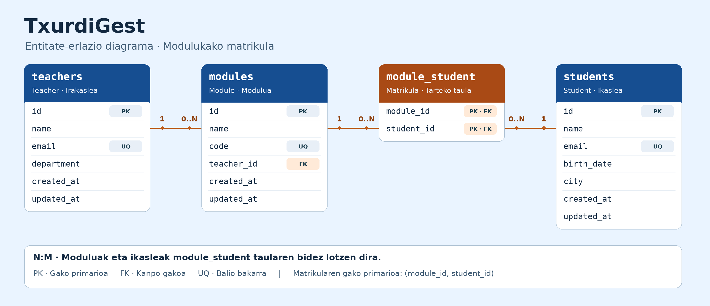

# TxurdiGest · Crear el proyecto

TxurdiGest es una aplicación de gestión para un centro de Formación Profesional. En este ejercicio guiado trabajaremos con **matrículas por módulo**. En la ficha del estudiante Jon veremos en qué módulos está matriculado. En la ficha del módulo, por su parte, veremos quién es el profesor y qué estudiantes están matriculados.

| Entidad | Modelo | Tabla | Campos iniciales |
| --- | --- | --- | --- |
| Estudiante | `Student` | `students` | `id`, `name`, `email`, marcas de tiempo |
| Profesor | `Teacher` | `teachers` | `id`, `name`, `email`, marcas de tiempo |
| Módulo | `Module` | `modules` | `id`, `name`, `code`, `teacher_id`, marcas de tiempo |
| Matrícula | — | `module_student` | `module_id`, `student_id` |

Un profesor puede impartir más de un módulo (1:N). Un estudiante puede matricularse en más de un módulo y un módulo puede tener más de un estudiante (N:M). En este ejercicio, las matrículas corresponden a un único curso académico. En clase utilizaremos datos ficticios.



## Instalar Laravel 13

Abre un terminal en la carpeta donde quieras guardar el proyecto. Comprueba que el terminal encuentra PHP 8.3 o posterior y Composer.

```bash
composer create-project laravel/laravel txurdigest "^13.0"
cd txurdigest
php artisan serve
```

Abre `http://127.0.0.1:8000` en el navegador para ver la aplicación.

Si utilizas el instalador de Laravel, otra opción es ejecutar `composer global require laravel/installer` y, después, `laravel new txurdigest`. Elige una instalación sin starter kit y comprueba que la versión es 13.x con el comando `php artisan --version`.

> En lugar de `php artisan serve`, también se puede utilizar `composer run dev`: inicia a la vez el servidor, Vite, la cola y los registros.


<a href="https://laravel.com/framework/docs/13.x/installation" target="_blank">Instalación de Laravel 13</a>

## Primera ruta, controlador y vista Blade

```bash
php artisan make:controller HomeController
```

`routes/web.php`

```php
<?php

use App\Http\Controllers\HomeController;
use Illuminate\Support\Facades\Route;

Route::get('/', [HomeController::class, 'index'])->name('home');
```

`app/Http/Controllers/HomeController.php`

```php
<?php

namespace App\Http\Controllers;

use Illuminate\View\View;

class HomeController extends Controller
{
    public function index(): View
    {
        return view('home.index');
    }
}
```

Crea las carpetas y los archivos en las siguientes rutas.

`resources/views/layouts/app.blade.php`

```blade
<!doctype html>
<html lang="es">
<head>
    <meta charset="utf-8">
    <meta name="viewport" content="width=device-width, initial-scale=1">
    <title>@yield('title', 'TxurdiGest') · TxurdiGest</title>
    <link rel="stylesheet" href="{{ asset('css/app.css') }}">
</head>
<body>
    <header>
        <nav aria-label="Navegación principal">
            <a href="{{ route('home') }}">TxurdiGest</a>
            <!-- Aquí añadiremos el menú de navegación -->
        </nav>
    </header>

    <main>
        @yield('content')
    </main>

    <footer>FP Txurdinaga</footer>
</body>
</html>
```

`resources/views/home/index.blade.php`

```blade
@extends('layouts.app')

@section('title', 'Inicio')

@section('content')
    <h1>TxurdiGest</h1>
    <p>Gestiona estudiantes, profesores, módulos y matrículas.</p>
@endsection
```

`public/css/app.css`

```css
body {
    max-width: 65rem;
    margin: auto;
    padding: 1rem;
    font: 1rem/1.6 system-ui, sans-serif;
    color: #172533;
}

nav, .pagination {
    display: flex;
    flex-wrap: wrap;
    gap: 1rem;
}

main { margin-block: 2rem; }
footer { border-top: 1px solid #cbd5e1; padding-top: 1rem; }
label { display: block; margin-top: .75rem; }
input, select, button { font: inherit; }
button { margin-top: .75rem; }
.error { color: #a31324; }
```

Si aparece el texto de bienvenida y el comando `php artisan route:list` muestra la ruta `home`, ya podemos empezar con la base de datos.

[Siguiente · Base de datos](datu-basea.md)
