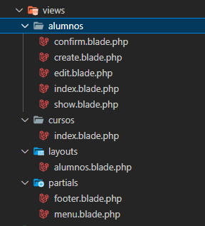

# Layouts

## Componentes

Hoy en día, al crear una plantilla, la mayoría de los programadores suelen utilizar componentes. Para hacerlo, lo utilizaríamos como si fuera un componente normal.

Por ejemplo, crearíamos el archivo app-layout.blade.php con la estructura HTML general: html, head, body, footer, etc. Nuestro slot sería el contenido de la página:

```php
<body>

    <header>

        <h1>Webgunearen goiburua</h1>

    </header>

    <main>

        {{ $slot }}

    </main>

    <footer>

        <p>Webgunearen oinarria</p>

    </footer>

</body>
```

Y, por ejemplo, en nuestra página de inicio utilizaríamos ese componente como hemos visto hasta ahora:

```html
<x-app-layout>

    <h1 class="text-3xl font-bold underline px-20">
        Hau da nire blog-aren lehenengo orria. Ongi etorri!!
    </h1>

    Eta hemen kodea jarraitzen du

</x-app-layout>
```

## Plantillas base (layouts)

Los layouts pueden resultar útiles para combinar la construcción de nuestras vistas.

Por un lado podemos utilizar @include para reutilizar código separado:

```php
@include('footer')

//Hala, view-en zuzenean gordetako elementu bat sartuko dugu, php edo luzapena duena blade.php
```

Función auxiliar asset()

El helper asset() nos proporciona la URL absoluta de nuestro archivo; de esta manera evitaremos tener que cambiar la ruta del archivo según la URL que tengamos.

```php
<link href="{{ asset('css/style.css') }}" rel="stylesheet">
```

Pero lo más útil sería utilizar layouts. En lugar de dividir nuestra plantilla en varios archivos, podemos crear una plantilla que contenga toda la estructura de nuestro sitio. Por ejemplo, podemos llamarla app.blade.php e incluir dentro todo el código de diseño. Normalmente se guardan en la subcarpeta layout.

Dentro de la plantilla podemos indicar secciones con la directiva @yield, pasando como argumento el nombre de la sección; después, en cada plantilla, incluiríamos el código correspondiente a cada sección:

```php
<main role="main" class="container">

    @yield('content')

</main>
```

Los layouts pueden tener cualquier nombre, pero siempre deben tener la extensión .blade.php.

La directiva @yield se puede utilizar de varias maneras; por ejemplo, para personalizar el título de nuestro sitio web.

```html
    <title>@yield('title') - Nireweb.net</title>
```

También podemos asignar un valor predeterminado a las directivas @yield; por ejemplo:

```html
    <title> @yield('title', 'Lehenetsiko titulua')</title>
```

Utilizaremos @section para definir las secciones y la directiva @yield para situarlas en nuestra plantilla (nuestro layout).

Por tanto, las secciones utilizarán la directiva @section y le pasaremos como argumento el nombre correspondiente:

```php
@section('title') Usuario {{ $id }} @endsection

@section('content')

<!-- Contenido de la sección -->

@endsection
```

En el ejemplo anterior, como title ocupa una sola línea, podemos pasar el título como parámetro:

```php
@section('title', "Usuario {$id}")
```

## Extender una plantilla

En lugar de incluir el encabezado o el pie de página en cada plantilla individual, le indicaremos a Laravel que la vista extienda app.blade.php.

No es necesario incluir la extensión del archivo ni su ruta completa, porque Laravel buscará el archivo en resources/view de forma predeterminada. En nuestro caso, como hemos guardado la plantilla en la carpeta layouts, lo haríamos así:

```php
@extends('layouts.app')
```

Una vez hecho esto, crearemos las secciones:

```php
@section('content')
    <!-- Contenido de la sección -->
@endsection
```

## Directiva @stack

Además de @yield(), también podemos utilizar la directiva @stack. Normalmente utilizaremos @yield cuando vayamos a usar el contenido una sola vez, por ejemplo, como hemos hecho con title. En otros casos, puede interesarnos ir añadiendo elementos a ese contenido, como código CSS o JS...

```php
@stack('css')
```

Para añadir contenido utilizaremos la directiva @push; podemos usar esta directiva varias veces a lo largo del código:

```php
@push('css')
    <style> body {background-color: darkcyan}</style>
@endpush

@section('content')

@push('css')
    <style> h1 { color: rgb(16, 34, 133)}</style>
@endpush

<h1 class="text-3xl font-bold underline px-20">
    Hau da nire blog-aren lehenengo orria. Ongi etorri!!
</h1>
```

## Partials

Además de los layouts, también existen archivos llamados partials; son pequeños fragmentos de código que normalmente se utilizan en partes concretas del sistema, como menús, pies de página, etc.

Siguiendo el siguiente ejemplo, las llamadas desde la plantilla alumnos.blade.php deberían hacerse como se muestra en este código:

```php
<body>
    @include('partials.menu')

    @yield('content')

    @include('partials.footer')
</body>
```


