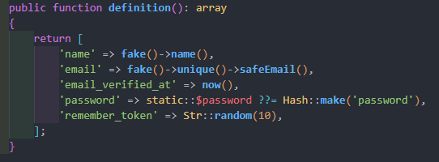

# Fábricas (Factories)

Documentación: <https://laravel.com/framework/docs/13.x/eloquent-factories>

Los seeders son una buena opción cuando tenemos pocos datos, pero existe otra opción para cuando necesitamos muchos datos de prueba: las factories. Son clases pensadas para el desarrollo. Laravel 11 ya tiene creada una factory llamada UserFactory.

Las factories son bastante fáciles de utilizar; hay que seguir los siguientes pasos:

1. Crearemos una clase llamada PostFactory:

```bash
php artisan make:factory PostFactory
```

2. Como vemos, se ha creado un archivo PostFactory.php en la carpeta database > factories.
3. Dentro de la función Definition, asignaremos un valor aleatorio a cada campo de la tabla; podemos hacerlo gracias al componente Faker.
4. Faker es una biblioteca de PHP que genera datos aleatorios; puede crear nombres, direcciones, teléfonos, etc.

Para ver todos los datos que puede generar Faker, entra en [este enlace](https://github.com/fzaninotto/Faker#formatters) o también en <https://fakerphp.org/>

5. Siguiendo con nuestro ejemplo, crearíamos un registro como este:



6. Ahora tenemos que indicar en DatabaseSeeder que, en lugar de invocar primero el seeder, ejecute la factory. Como se ve en el código, podemos indicar cuántas veces lo ejecutará, es decir, cuántos datos creará. En este caso generará los datos de 10 posts:

```php
use App\Models\Post;

public function run()    {
    $this->call(PostSeeder::class); // Seederrean sortutakoak  

    Post::factory(10)->create();  // Gure factory-ari 10 biderretan deituko du, beraz, 10 erregistro sortuko ditu.
}
```

Una vez hecho esto, volveremos a ejecutar el seeder:

```bash
php artisan db:seed
```

Para ver los distintos formatos de Faker:

<https://github.com/fzaninotto/Faker#formatters>

<https://fakerphp.org/>
