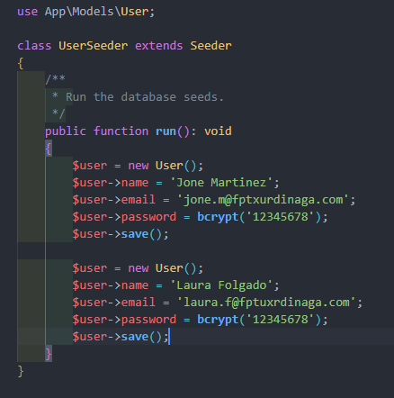
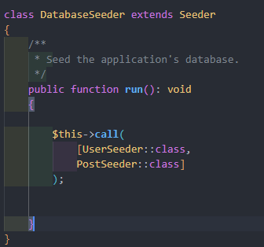

# Seeders

Los seeders son componentes de Laravel que permiten introducir datos en la base de datos. Normalmente sirven para insertar datos durante el proceso de desarrollo o los datos que se necesitan al iniciar una aplicación.

¿Cómo lo haríamos?

Desde nuestro directorio, escribiríamos esta instrucción de Artisan para crear IkasleSeeder:

```bash
php artisan make:seeder UserSeeder
```

El archivo se creará en database > seeders.

En el archivo indicaremos cuál es nuestro modelo; para ello crearemos la referencia a la clase Ikasle:

```php
use App\Models\User;
```

Crearemos la variable $user y completaremos todas sus propiedades, como se muestra en la imagen. Como se puede ver, utilizaremos las tablas de nuestra base de datos como objetos.





Al ejecutar los seeders, Artisan invocará la clase DatabaseSeeder; por tanto, para ejecutar nuestro seeder, "invocaremos" (instanciaremos) nuestra clase desde el método run() de esa clase.

Se puede invocar más de uno desde este método; se ejecutarían en el orden en que se escriban.

```php
$this->call(UserSeeder::class);
```

Una vez hecho todo esto, ejecutaremos el seeder para cargar los datos en nuestra base de datos:

```bash
php artisan db:seed
```

En la imagen se ejecutan dos seeders; para ello los incluiremos en un array. También podríamos invocar el método call dos veces; eso sí, siempre en el orden que necesitemos:

```php
$this->call(UserSeeder::class);

$this->call(PostSeeder::class);
```

De esta manera solo se ejecutaría el seeder, pero a menudo queremos ejecutar los seeders al mismo tiempo que las migraciones. Para ello, ejecutaríamos el siguiente comando:

```bash
php artisan migrate:fresh --seed
```

En este caso, se eliminarán todas las tablas, se volverán a crear y se guardarán los datos indicados en el seeder.

Documentación oficial: <https://laravel.com/framework/docs/13.x/seeding>
