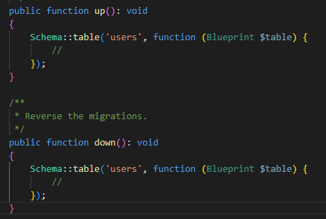

# Migraciones

¿Qué son las migraciones? Las migraciones son el sistema que utiliza Laravel para llevar el control de versiones de la base de datos. Gracias a ellas, los cambios realizados en la base de datos quedan documentados y controlados, de modo que otras personas también puedan ejecutarlos o, si surge algún problema, se pueda volver al estado anterior.

También podemos utilizar las migraciones para gestionar las tablas de la base de datos, es decir, para crear tablas nuevas, cambiar algún campo de una tabla o eliminarlo.

Las migraciones se guardarán en la carpeta database>migrations. Cada migración estará en un archivo PHP y, como podemos ver, contiene una clase Migration con dos métodos: up() y down(). Al ejecutar la migración, se invoca el método up(); al hacer reset, refresh u operaciones similares, se invoca down().

Artisan dispone de varios métodos para trabajar con migraciones: make:migration, migrate:refresh, migrate:reset y migrate:rollback.

make:migration

Se utiliza para crear una migración nueva.

```bash
php artisan make:migration create_pupils_taula

php artisan migrate
```

Ejecuta todas las migraciones que ya existen.

Laravel ejecuta siempre y automáticamente solo las migraciones que aún no se han ejecutado. No volverá a ejecutar las que ya se ejecutaron (porque están registradas en la tabla migrations).

```bash
php artisan migrate
```

migrate:rollback

Deshace las migraciones que se ejecutaron en el último batch o "lote".

Es decir, revierte todas las migraciones realizadas en la última ejecución (ejecutando down()).

El batch puede verse en el campo batch de la tabla migrations.

```bash
php artisan migrate:rollback
```

migrate:reset

Deshace todas las migraciones (invocando down()), no solo las del último lote.

```bash
php artisan migrate:reset
```

migrate:refresh

Primero ejecuta reset (todos los métodos down()) y después vuelve a ejecutar todas las migraciones (todos los métodos up()). Esto resulta muy útil durante el desarrollo para tener la base de datos "limpia".

```bash
php artisan migrate:refresh
```

migrate:fresh

Elimina FÍSICAMENTE todas las tablas y después ejecuta todos los métodos up().

No utiliza el método down(), por lo que es más peligroso.

## Crear una tabla nueva usando una migración

Para crear una tabla nueva, crearíamos una migración nueva usando la siguiente instrucción:

```bash
php artisan make:migration create_posts_table
```

Una vez creado el archivo, podemos ver que se ha generado una clase nueva; después modificaremos los métodos up() y down():

```php
public function up(): void{
    Schema::create('posts', function (Blueprint $table) {

        $table->id();

        $table->string('title');

        $table->text('content');

        $table->timestamps();
    });
}

// Reverse the migrations.


public function down(): void{

    Schema::dropIfExists('posts');

}
```

## ¿Cómo cambiar un campo de una tabla que ya tiene datos?

Para modificar los campos de una tabla también crearíamos una migración. Lo haríamos así si la base de datos contiene datos; si no los tiene, modificaríamos directamente la migración create y la ejecutaríamos toda con un refresh.

Por ejemplo, para añadir un campo nuevo a una tabla habría que crear una nueva migración. Como hemos dicho, el nombre de la migración puede ser cualquiera, pero, por "convención", lo escribiríamos así:

```bash
php artisan make:migration add_avatar_to_users_table
```



Se creará un documento de migración con los métodos anteriores; aquí añadiremos el campo como en el caso de create. Como la tabla ya tendrá datos, al crear el campo debemos indicar que puede ser null para evitar errores. Lo escribiremos en el método up().

```php
$table->string('avatar')->nullable();
```

En el método down() también tendremos que eliminar la columna.

```php
$table->dropColumn('avatar');
```

Al ejecutar esta migración, se ha añadido la columna avatar al final de la tabla. Si no queremos que quede ahí, haremos rollback y después cambiaremos la migración.

```bash
php artisan migrate
```

Supongamos que queremos colocarla después del campo email:

```php
$table->string('avatar')->nullable()->after('email');
```

Encontrarás la documentación oficial en el siguiente enlace: <https://laravel.com/framework/docs/13.x/migrations>

Siguiente: Eloquent
