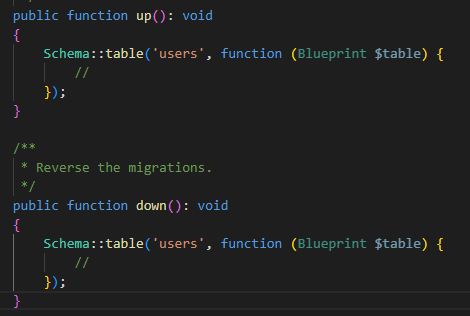

# Migraciones

## ¿Qué son las migraciones?

Las migraciones son el sistema que utiliza Laravel para llevar el control de versiones de la base de datos.

Gracias a ellas, los cambios realizados en la base de datos quedan documentados y controlados, de modo que otras personas también puedan ejecutarlos o, si surge algún problema, se pueda volver al estado anterior.

También podemos utilizar las migraciones para gestionar las tablas de la base de datos, es decir, para crear tablas nuevas, cambiar algún campo de una tabla o eliminarlo.

Las migraciones se guardan en la carpeta ```database>migrations```.

Cada migración está en un archivo PHP que contiene una clase Migration con dos métodos: ```up() y down()```. Al ejecutar la migración, se invoca el método ```up()```; al hacer reset, refresh u operaciones similares, se invoca el método ```down()```.

- **up()**: se utiliza para aplicar cambios en la base de datos (crear una tabla, añadir una columna...).
- **down()**: se utiliza para deshacer los cambios realizados por el método up().

Artisan dispone de varios métodos para trabajar con migraciones: ```make:migration, migrate:refresh, migrate:reset y migrate:rollback```.

## make:migration

Se utiliza para crear una migración nueva.

```bash
    php artisan make:migration create_pupils_table

    php artisan migrate
```

- ```make:migration:``` crea el archivo PHP de la migración, pero no modifica la base de datos.
- ```migrate:``` ejecuta las migraciones que aún no se han ejecutado y aplica los cambios en la base de datos.

Ejecuta todas las migraciones existentes. Estas migraciones se ejecutan según su fecha de creación: primero se ejecuta la más antigua.

!!! note
    Laravel ejecuta automáticamente solo las migraciones que aún no se han ejecutado. No volverá a ejecutar las que ya se ejecutaron (porque están registradas en la tabla migrations).

```bash
php artisan migrate
```

## migrate:rollback

Deshace las migraciones que se ejecutaron en el último batch o "lote".

Es decir, revierte todas las migraciones realizadas en la última ejecución (ejecutando down()).

El batch puede verse en el campo batch de la tabla migrations.

```bash
php artisan migrate:rollback
```

## migrate:reset

Deshace todas las migraciones (invocando down()), no solo las del último lote.

```bash
php artisan migrate:reset
```

## migrate:refresh

Primero ejecuta reset (todos los métodos down()) y después vuelve a ejecutar todas las migraciones (todos los métodos up()). Esto resulta muy útil durante el desarrollo para tener la base de datos "limpia".

```bash
php artisan migrate:refresh
```

## migrate:fresh

Elimina FÍSICAMENTE todas las tablas y después ejecuta todos los métodos up().

No utiliza el método down(), por lo que es más peligroso.

!!! warning
    ```migrate:fresh``` elimina todas las tablas de la base de datos, no solo las creadas por las migraciones. Por tanto, podríamos perder los datos que haya en la base de datos.

## migrate:status

Este comando permite **consultar el estado de cada migración**, es decir, comprobar si ya se ha ejecutado o si todavía está pendiente.

```bash
php artisan migrate:status
```

Al ejecutarlo, Laravel muestra una lista de todas las migraciones con su estado:

- **Ran**: la migración ya se ha ejecutado y está registrada en la tabla `migrations`.
- **Pending**: la migración está creada, pero todavía no se ha ejecutado.

También podemos ver el número de **batch** o lote de las migraciones ejecutadas. Este número indica en qué lote de ejecución se aplicó cada migración.

!!! tip
    Este comando resulta muy útil después de crear una migración para comprobar si hemos ejecutado `php artisan migrate`.

    Ten en cuenta que el comando `migrate:status` **no realiza cambios en la base de datos**; solo muestra información sobre el estado de las migraciones.

### Resumen de los comandos de migración

Laravel ofrece comandos de Artisan para crear, ejecutar y deshacer migraciones.

En la siguiente tabla se resumen los principales comandos y su función:

| Comando | ¿Qué hace? | ¿Se pueden perder datos? |
|---|---|---|
| `make:migration` | Crea un archivo de migración nuevo. | No |
| `migrate` | Ejecuta las migraciones que aún no se han ejecutado. | Depende del cambio |
| `migrate:status` | Muestra si cada migración se ha ejecutado. | No |
| `migrate:rollback` | Deshace las migraciones ejecutadas en el último lote (batch). | Sí |
| `migrate:reset` | Deshace todas las migraciones ejecutadas. | Sí |
| `migrate:refresh` | Deshace todas las migraciones y vuelve a ejecutarlas. | Sí |
| `migrate:fresh` | Elimina todas las tablas de la base de datos y vuelve a ejecutar todas las migraciones. | Sí |

!!! warning "¡Cuidado con los datos!"
    Los comandos `rollback`, `reset`, `refresh` y `fresh` pueden provocar la eliminación de datos.

    En particular, los comandos `refresh` y `fresh` se utilizan en entornos de desarrollo para volver a crear la base de datos. No deben utilizarse si necesitamos conservar los datos.

!!! tip "¿Cuál es la diferencia entre refresh y fresh?"
    - **`migrate:refresh`**: deshace las migraciones utilizando los métodos `down()` y, después, vuelve a ejecutarlas mediante los métodos `up()`.
    - **`migrate:fresh`**: elimina directamente todas las tablas de la base de datos, sin utilizar los métodos `down()`, y después ejecuta todas las migraciones.

    Por tanto, `fresh` puede resultar útil incluso cuando los métodos `down()` de las migraciones no están definidos correctamente.

## Crear una tabla nueva usando una migración

Para crear una tabla nueva, crearíamos una migración nueva usando la siguiente instrucción:

```bash
php artisan make:migration create_posts_table
```

!!! note
    Al crear una migración, conviene que su nombre indique qué hará. En Laravel, para crear una tabla nueva, normalmente se utiliza esta estructura:

    `create_nombre_table`

    - **`create`**: indica que vamos a crear una tabla nueva.
    - **`posts`**: es el nombre de la tabla que vamos a crear. Por convención, se escribe en minúsculas y en plural.
    - **`table`**: indica que la migración afecta a una tabla de la base de datos.

    Por tanto, el nombre `create_posts_table` indica que vamos a crear una tabla llamada **posts**.

Una vez creado el archivo, podemos ver que se ha generado una clase nueva; después modificaremos los métodos up() y down():

```php
    public function up(): void{
        Schema::create('posts', function (Blueprint $table) {
            $table->id();
            $table->string('title');
            $table->text('content');
            $table->timestamps();
        });
    }

    // Reverse the migrations.

    public function down(): void{
        Schema::dropIfExists('posts');
    }
```

## ¿Cómo cambiar un campo de una tabla que ya tiene datos?

Para modificar los campos de una tabla también crearíamos una migración.

Lo haríamos así si la base de datos contiene datos; si no los tiene, modificaríamos directamente la migración create y la ejecutaríamos toda con un refresh.

Por ejemplo, para añadir un campo nuevo a una tabla habría que crear una nueva migración. Como hemos dicho, el nombre de la migración puede ser cualquiera, pero, por "convención", lo escribiríamos así:

```bash
php artisan make:migration add_avatar_to_users_table
```



Se creará un documento de migración con los métodos anteriores; aquí añadiremos el campo como en el caso de create.

!!! warning
    Como la tabla ya tendrá datos, al crear el campo debemos indicar que puede ser null para evitar errores, o asignarle un valor por defecto. Lo escribiremos en el método up().

```php
    public function up(): void
    {
        Schema::table('users', function (Blueprint $table) {
            $table->string('avatar')->nullable();
        });
    }

    public function down(): void
    {
        Schema::table('users', function (Blueprint $table) {
            $table->dropColumn('avatar');
        });
    }
```

Al ejecutar esta migración, se ha añadido la columna avatar al final de la tabla. Si no queremos que quede ahí, haremos rollback y después cambiaremos la migración.

```bash
php artisan migrate
```

Supongamos que queremos colocarla después del campo email:

```php
$table->string('avatar')->nullable()->after('email');
```

## Tipos de columna más habituales

En las migraciones, al crear o modificar una tabla, debemos especificar **qué tipo de datos se guardarán en cada columna**.

Laravel ofrece varios métodos para definir columnas. Estos son algunos de los más habituales:

| Método | Descripción | Ejemplo |
|---|---|---|
| `string()` | Texto corto (por defecto, de hasta 255 caracteres). | `$table->string('name');` |
| `text()` | Para guardar texto largo. | `$table->text('description');` |
| `integer()` | Para guardar números enteros. | `$table->integer('age');` |
| `boolean()` | Para guardar valores de tipo verdadero/falso. | `$table->boolean('active');` |
| `date()` | Para guardar fechas, sin hora. | `$table->date('birth_date');` |
| `decimal()` | Para guardar números decimales con precisión fija. | `$table->decimal('price', 8, 2);` |
| `foreignId()` | Crea una columna ID para hacer referencia a un registro de otra tabla. | `$table->foreignId('user_id');` |
| `timestamps()` | Crea automáticamente las columnas `created_at` y `updated_at`. | `$table->timestamps();` |

!!! note "Ten en cuenta"
    - Con `decimal('price', 8, 2)` se pueden guardar hasta 8 dígitos, de los cuales 2 son decimales.
    - Con `foreignId()` se crea la columna ID, pero **no se crea automáticamente la restricción de clave foránea**. Para ello se puede utilizar `constrained()`.
    - El método `timestamps()` crea dos columnas que Eloquent puede gestionar automáticamente.

## Propiedades de las columnas

Además de definir el tipo de dato de una columna, también podemos establecer **propiedades adicionales**.

Estas propiedades sirven para especificar qué valores acepta la columna o cómo se comporta.

| Propiedad | Descripción |
|---|---|
| `nullable()` | Permite que la columna acepte el valor `NULL`. |
| `default()` | Establece el valor que se utilizará si no se especifica ninguno. |
| `unique()` | Impide que haya valores repetidos en la columna mediante una restricción de la base de datos. |

**Ejemplo:**

```php
$table->string('email')->unique();
$table->boolean('active')->default(true);
$table->string('avatar')->nullable();
```

- **`email`**: la dirección de correo electrónico no se podrá repetir.
- **`active`**: si no se indica ningún valor, será `true` por defecto.
- **`avatar`**: si el usuario no tiene una imagen, la columna podrá tener el valor `NULL`.

!!! tip
    Podemos encadenar varios métodos en la definición de una columna:

    ```php
    $table->string('username', 50)->nullable()->unique();
    ```

    En este caso, la columna `username` tendrá un máximo de 50 caracteres, aceptará el valor `NULL` y no permitirá que se repitan los valores que no sean `NULL`.

Encontrarás la documentación oficial en el siguiente enlace: <https://laravel.com/framework/docs/13.x/migrations>

Siguiente: Eloquent
