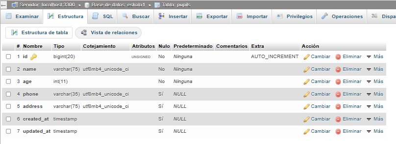

# Validaciones

## Validaciones

Laravel incorpora algunos métodos que nos sirven para realizar validaciones. Las haremos antes de insertar un dato en la base de datos.

Antes que nada, comprobaremos qué datos de nuestra base de datos son obligatorios, qué tipo de datos son, etc.



1. Controlaremos los errores dentro del método store(). Utilizamos como parámetro del método store() el objeto Request, que recoge todos los datos del formulario. Después se lo pasamos al método validate() en un array donde se especifican los campos del formulario y sus reglas de validación.

Laravel indica que, si en algún momento no se cumple una validación, no se pasará a la siguiente línea de código y se producirá un error. En cambio, si todas las validaciones son correctas, continuará.

En nuestro caso escribiremos esto en el método store() para validar todos los datos:

```php
$validated = $request->validate([
```

'name' => 'required|string|max:75',

'age' => 'required|integer|min:0',

'phone' => 'required|string|max:20',

'address' => 'required|string|max:75',

]);

Pupil::create($validated);

Mostrar los errores en mensajes

2. Ahora veremos nuestros formularios. En ellos mostraremos los mensajes en los campos del formulario cuando haya errores de validación definidos en nuestros controladores.

3. Antes de empezar a validar los formularios, añadiremos código CSS a todas nuestras vistas para dar estilo a los mensajes de error.

p { color: red; }

Validar el formulario en la vista de alumnos

4. Crearemos todas las validaciones en la vista create.blade.php.

En el campo Nombre y apellidos, debajo del elemento Input, añadiremos el código de validación del campo mediante la directiva que nos ofrece Blade. La opción @error permite imprimir el mensaje de error correspondiente a este campo.

```php
@error('name')

<p class="error-message">{{ $message }}</p>
```

@enderror

5. Añadiremos al input el método old(), que es una directiva de Blade. Así conseguiremos conservar el dato introducido antes de la validación.

```php
<input type="text" name="name" placeholder="Izena" value="{{ old('name') }}">
```

6. Haremos lo mismo con el campo de la edad:

```php
<label>Adina:</label>

<input type="text" name="age" placeholder="Adina" value="{{ old('age') }}">

@error('age')

<p class="error-message">{{ $message }}</p><br>
```

@enderror

7. También conservaremos el teléfono y la dirección introducidos:

```php
<label>Telefonoa:</label>

<input type="text" name="phone" placeholder="Telefonoa" value="{{ old('phone') }}">

<label>Helbidea:</label>

<input type="text" name="address" placeholder="Helbidea" value="{{ old('address') }}">
```

8. ¿Qué ocurre si hacemos la validación al editar? En ese caso, la primera vez que entramos en el formulario queremos obtener el dato de la base de datos y, si hay un error, el valor que nos devuelve el método old. Para ello, pasaremos un segundo parámetro al método old:

```php
<label>Telefonoa:</label>

<input type="text" name="phone" placeholder="Telefonoa" value="{{ old('phone', $pupil->phone) }}">
```

Como vemos, los mensajes aparecerán en inglés; si queremos cambiarlo, tendremos que cambiar el idioma.

9. Hay otra forma de mostrar todos los errores desde el principio:

```php
@if ($errors->any())
```

Errores:

```php
<ul>

@foreach ($errors->all() as $error)

<li>{{ $error }}</li>
```

@endforeach

```php
</ul>

@endif
```

Solicitud de formulario (Form Request)

Si hacemos muchas validaciones en nuestra aplicación, nuestro código puede quedar muy desordenado. Para ello podemos utilizar Form Request, lo que significa que pondremos el código de validación en un archivo nuevo.

Abrimos el terminal y escribimos el siguiente código; en este caso añadiremos la validación que haremos en el método store del controlador Pupil:

```bash
php artisan make:request StorePupil
```

Veremos que se ha creado un archivo nuevo en la carpeta Http>Request.

En este archivo se ha creado una clase llamada StorePupil que tiene dos métodos: athorize() y rules().

El primero sirve para comprobar si el usuario tiene permisos o no, pero normalmente no se hace así, sino que se suelen utilizar policies; por tanto, aquí asignaremos el valor true para poder ejecutar el siguiente método.

En el método rules() pondremos las validaciones que tenemos en el controlador:

```php
namespace App\Http\Requests;

use Illuminate\Foundation\Http\FormRequest;

class StorePupilRequest extends FormRequest

{

public function authorize(): bool

{

return true;

}

public function rules(): array

{

return [
```

'name'    => 'required|string|max:75',

'age'     => 'required|integer|min:0',

'phone'   => 'nullable|string|max:35',

'address' => 'nullable|string|max:75',

];

}

En el controlador eliminaríamos las validaciones y, en el método store(), en lugar de una instancia del objeto Request, indicaremos que sea una instancia del objeto StoreRequest.

```php
public function store(StorePupil $request){
```

Si queremos cambiar los mensajes de validación, por ejemplo, traducirlos al euskera, crearíamos un método message(), como se ve en el siguiente ejemplo:

```php
public function rules(): array

{

return [
```

'name'    => 'required|string|max:75',

'age'     => 'required|integer|min:0',

'phone'   => 'nullable|string|max:35',

'address' => 'nullable|string|max:75',

];

}

```php
public function messages(): array

{

return [
```

'name.required' => 'Izena derrigorrezkoa da.',

'age.required'  => 'Adina derrigorrezkoa da.',

'age.integer'   => 'Adina zenbaki osoa izan behar da.',

// eta horrelakoak…

];

}

También podemos cambiar aquí los nombres de los atributos; para ello utilizaríamos el método attributes(), aunque es mejor hacerlo en el archivo validation.php.

```php
public function attributes(): array

{

return [
```

'name'    => 'Izena',

'age'     => 'Adina',

'phone'   => 'Telefonoa',

'address' => 'Helbidea',

];

}

Encontrarás todas las validaciones de Laravel en el siguiente enlace: <https://laravel.com/framework/docs/13.x/validation#available-validation-rules>
