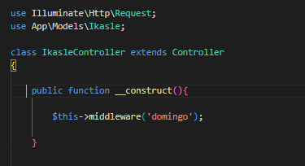

# Middleware

## ¿Qué es un middleware?

Un middleware de Laravel es una clase que funciona como filtro de las rutas; es decir, podemos añadir un middleware a una ruta o a un grupo de rutas, por ejemplo, para impedir que los usuarios accedan a ellas si no están autenticados en nuestra aplicación.

El middleware de Laravel más conocido y utilizado es uno de los que se crean por defecto: el middleware authenticate, que comprueba si un usuario ha iniciado sesión en nuestra aplicación. Si añadimos el middleware de autenticación a nuestras rutas y comprueba que el usuario no está autenticado, por defecto lo redirigirá a la ruta de inicio de sesión.

Es decir, es una condición que ponemos en nuestras rutas; por tanto, al realizar la solicitud hará una cosa u otra.

Laravel tiene algunos middlewares predeterminados; los guarda en la carpeta app>http>Middleware y también en el archivo kernel.php.

Por ejemplo, podemos ver que Laravel utiliza dos: api y web, en Providers > RouteServiceProvider.php. Pero también podemos crear nuestros propios middlewares:

## Crear un middleware:

Para crear un middleware utilizaremos Artisan de la siguiente manera:

```bash
php artisan make:middleware DomingoMiddleware
```

Este comando añadirá una clase nueva al directorio app/Http/Middleware. Nuestro middleware hará algo al detectar que es domingo. El comando de Artisan crea un middleware básico que tendrá un único método, llamado handle().

Este método comprobará si es domingo y, si lo es, mostrará un mensaje. Para ello añadiremos el siguiente código en nuestro método:

if(date('w')==='0'){

echo "Igandea da!";

}else{

echo "Gaur ez da igandea";

}

```php
return $next($request); // Honek esan nahi du aurrera jarraituko duela
```

En este ejemplo mostraremos el mensaje con un echo. Como sabemos, no se hace así; solo lo haremos para este ejemplo, porque todos los mensajes deberían mostrarse mediante vistas y, además, los middlewares suelen utilizarse para dirigir al usuario a un sitio u otro.

## Registrar el middleware

Ahora registraremos el middleware para ver cómo se ejecuta en el sistema. Empezaremos registrándolo globalmente, para que se ejecute en todas las solicitudes que recibe nuestra aplicación.

Es muy sencillo; se hace desde el archivo Kernel.php (está en la ruta app/Http/Kernel.php).

Para registrarlo de forma global

Lo escribiremos en la propiedad de la clase Kernel que contiene todos los middlewares que pueden ejecutarse globalmente:

```php
protected $middleware = [
```

.....

\App\Http\Middleware\DomingoMiddleware::class,

];

Como vemos, hemos incluido nuestro middleware en el array de middlewares que se ejecutarán; en este caso será el último elemento, lo que significa que será el middleware con menor prioridad. Si queremos aumentar su prioridad, debemos colocarlo antes en el array.

Después de registrar el middleware globalmente, puedes entrar en cualquier página de la aplicación y deberías ver el resultado del middleware, que te indica si es domingo o no.

Registrar un middleware para una ruta concreta o un único controlador

Hay varias formas de hacerlo, tanto desde el sistema de rutas como desde los controladores, pero siempre debemos empezar asignando un nombre a nuestro middleware en el archivo Kernel.php. Allí, en la clase Kernel, hay una segunda propiedad llamada $routeMiddleware, que contiene un array con los middlewares que queremos utilizar en las rutas.

Cada elemento del array tiene un índice, que será el nombre que asignamos al middleware para hacer referencia a él desde el sistema de rutas.

```php
protected $routeMiddleware = [
```

................

'domingo' => \App\Http\Middleware\DomingoMiddleware::class,

];

Ahora podemos ejecutar el middleware mediante el índice que indicamos en el array anterior.

Hay tres opciones para hacerlo:

1. Desde el sistema de rutas, al definir la ruta podemos indicar qué middleware queremos utilizar. Hay que hacerlo desde el registro de rutas, en el archivo enrutador routes/web.php, utilizando la sintaxis que puedes ver a continuación.

```php
Route::get('/test', ['middleware' => 'domingo', function(){

return 'Middleware ibilbidea frogatzen';

}]);
```

2. También podemos crear un grupo de rutas desde el sistema de rutas para ejecutar ese middleware.

```php
Route::group(['middleware' => 'domingo'], function(){

Route::get('/probando/ruta', function(){

//código a ejecutar cuando se produzca esa ruta y el verbo

return 'get';

});

Route::post('/probando/ruta', function(){

//código a ejecutar cuando se produzca esa ruta y el verbo POST

return 'post';

});
```

3. También podemos invocar un middleware desde un controlador. Podemos hacerlo desde el constructor; por tanto, este middleware afectará a todas las acciones del controlador.

```php
public function __construct(){

$this->middleware('domingo');

}
```



En este caso no tenemos que mencionar el middleware desde el sistema de rutas; basta con mencionarlo en el constructor del controlador para que se ejecute en cualquiera de las acciones declaradas allí.

## Encadenar un middleware con el siguiente:

Según la filosofía de los middlewares de Laravel, para cada solicitud puede haber varios que se ejecutan en cadena, uno detrás de otro. Por eso debemos asegurarnos de que ese encadenamiento pueda producirse. En realidad, el middleware que se crea con Artisan ya hace ese trabajo, así que no tenemos que preocuparnos. Aun así, queremos ver dónde se realiza ese procesamiento en cadena.

Veamos el método handle() del middleware creado automáticamente:

```php
public function handle($request, Closure $next){

return $next($request);

}
```

Como se puede ver, este método devuelve una llamada a $next() al retornar, pasando $request como parámetro. Gracias a esa llamada se puede ejecutar el siguiente middleware de la lista de middlewares globales y, además, se envía la solicitud completa al siguiente middleware para que siga filtrándola.

Por defecto, no tenemos que hacer nada manualmente; Laravel proporciona los parámetros $request y $next al método handle. Además, Laravel sabe si ese middleware es el último de la lista y, en ese caso, no debería haber más encadenamientos.

Nuestro trabajo consiste simplemente en dejar el return predeterminado para que todo siga funcionando.

<https://laravel.com/framework/docs/13.x/middleware#defining-middleware>
