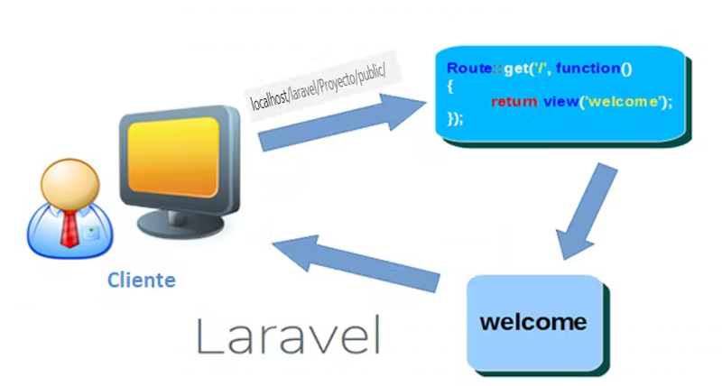
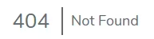

# Rutas

Una ruta (*route*) vincula una solicitud HTTP con una acción. Cuando llega una solicitud, Laravel busca una ruta que coincida con su método HTTP y la ruta de su URI, y ejecuta la acción de esa ruta.

Escribimos las rutas de la interfaz web en el archivo `routes/web.php`. Para utilizar la clase `Route` en los ejemplos, asegúrate de que esta importación aparece al principio del archivo:

```php
use Illuminate\Support\Facades\Route;
```

[Documentación oficial de Laravel 13 · Routing](https://laravel.com/framework/docs/13.x/routing)

## Métodos HTTP

| Método | ¿Para qué se suele utilizar? |
| --- | --- |
| `GET` | Para obtener una página o algunos datos. |
| `POST` | Para enviar datos. Por ejemplo, para crear un recurso nuevo. |
| `PUT` | Para sustituir por completo el contenido de un recurso. |
| `PATCH` | Para actualizar una parte de un recurso. |
| `DELETE` | Para eliminar un recurso. |

Se puede utilizar la misma URI con métodos diferentes. Por ejemplo, `GET /test` y `POST /test` son rutas distintas.

```php
Route::get('/test', function () {
    return 'Método GET';
});

Route::post('/test', function () {
    return 'Método POST';
});

Route::put('/test', function () {
    return 'Método PUT';
});

Route::patch('/test', function () {
    return 'Método PATCH';
});

Route::delete('/test', function () {
    return 'Método DELETE';
});
```

Al escribir una URL en la barra de direcciones del navegador, este realiza una solicitud `GET`. Para probar `POST`, por ejemplo, podemos utilizar `method="POST"` y `@csrf` en un formulario Blade. Veremos los formularios correspondientes a los métodos `PUT`, `PATCH` y `DELETE` en la sección CRUD.

## Enrutamiento básico

En un proyecto Laravel nuevo, es habitual que las rutas iniciales muestren la vista `welcome`:

```php
Route::get('/', function () {
    return view('welcome');
});
```

Para probarlo, sustituye la ruta anterior por esta:

```php
Route::get('/', function () {
    return '¡Bienvenido!';
});
```

El primer argumento de `Route::get()` es la ruta de la URI. El segundo es la acción que se ejecutará cuando una solicitud `GET` coincida con esa ruta. En el ejemplo, la acción es una función anónima y su `return` proporciona el contenido de la respuesta.




## Rutas fijas

Supongamos que queremos crear las direcciones `/1`, `/2` y `/3`. Podemos definir una ruta para cada dirección:

```php
Route::get('/1', function () {
    return '¡Soy la página 1!';
});

Route::get('/2', function () {
    return '¡Soy la página 2!';
});

Route::get('/3', function () {
    return '¡Soy la página 3!';
});
```

Si lo único que cambia es el número de la página, podemos sustituir las tres rutas por una ruta con un parámetro.

## Rutas con parámetros

### Un parámetro

El parámetro `{number}`, escrito entre llaves, recibe el valor de un segmento de la URL. Laravel pasa ese valor a la función.

```php
Route::get('/{id}', function (string $id) {
    return 'El número de mi página: ' . e($id) . '!';
});
```

En la solicitud `GET /2`, la variable `$id` toma el valor `'2'`. La solicitud `GET /4` también coincide con la ruta. En cambio, si solo estuvieran definidas las tres rutas fijas anteriores, la dirección `/4` devolvería un error 404.


### Dos parámetros

```php
Route::get('/posts/{category}/{id}', function (string $category, string $id) {
    return 'Categoría: ' . e($category) . ', publicación: ' . e($id);
});
```

| Solicitud | Resultado |
| --- | --- |
| `GET /posts/technology/7` | `Categoría: technology, publicación: 7` |
| `GET /posts/music/12` | `Categoría: music, publicación: 12` |
| `GET /posts/music` | 404, si no hay otra ruta que coincida con la solicitud. |

El helper `e()` prepara el valor recibido de la URL para mostrarlo como texto en HTML.

### Parámetro opcional y valor predeterminado

Para que un parámetro sea opcional, escribe `?` después del nombre y proporciona un valor predeterminado al argumento de la función.

```php
Route::get('/welcome/{name?}', function (string $name = 'invitado') {
    return 'Hola, ' . e($name);
});
```

| Solicitud | Respuesta |
| --- | --- |
| `GET /welcome` | `Hola, invitado` |
| `GET /welcome/Jon` | `Hola, Jon` |

El valor predeterminado se utiliza cuando falta el segmento. Si también estás probando la ruta general anterior `/{id}`, coloca `/welcome/{name?}` antes de ella, ya que la dirección `/welcome` coincide con ambas rutas.

## Orden de las rutas

Cuando dos rutas pueden coincidir con el mismo método HTTP y la misma ruta, coloca **primero la ruta más específica**. En este ejemplo, la dirección `/contact` coincide con la ruta fija y con la ruta dinámica `/{number}`.

Para ver el orden, elimina la definición anterior de `/{id}` y utiliza este bloque:

```php
Route::get('/contact', function () {
    return 'Página de contacto';
});

Route::get('/{id}', function (string $id) {
    return 'El número de mi página: ' . e($id) . '!';
});
```

- En este orden, la solicitud `GET /contact` muestra `Página de contacto`.
- Si se intercambia el orden de las dos rutas, la primera recibe `contact` como parámetro y muestra `El número de mi página: contact!`.
- La solicitud `GET /7` utiliza la ruta dinámica en ambos órdenes.

## Restricciones de los parámetros

El nombre del parámetro `{id}` no limita su contenido a números. Para ello, debemos añadir una restricción a la ruta.

### Expresión regular con `where()`

```php
Route::get('/users/{id}', function (string $id) {
    return 'Usuario: ' . $id;
})->where('id', '[0-9]+');
```

La expresión `[0-9]+` acepta uno o más dígitos.

### Helpers para restricciones

Podemos sustituir la definición anterior de `/users/{id}` por `whereNumber()`:

```php
Route::get('/users/{id}', function (string $id) {
    return 'Usuario: ' . $id;
})->whereNumber('id');
```

La solicitud `GET /users/7` mostrará `Usuario: 7`. En cambio, la solicitud `GET /users/alex` devolverá un error 404 si no coincide con otra ruta. La ruta `/users/999` cumple la condición porque contiene dígitos. Comprobar si el usuario existe realmente es responsabilidad de la aplicación.

| Helper | Valor que acepta |
| --- | --- |
| `whereNumber('id')` | Dígitos. |
| `whereAlpha('category')` | Letras de `a–z` o `A–Z`. |
| `whereAlphaNumeric('code')` | Letras y dígitos alfanuméricos (`a–z`, `A–Z`, `0–9`). |
| `whereIn('category', ['music', 'technology'])` | Los valores que aparecen en la lista. |




## Rutas con nombre

Podemos asignar un nombre a una ruta mediante el método `name()`. Después, el helper `route()` genera su URL. Para probar el ejemplo de la ruta inicial, añade `->name('home')` a la definición existente:

```php
Route::get('/', function () {
    return '¡Soy la página de inicio!';
})->name('home');
```

En una vista Blade:

```blade
<a href="{{ route('home') }}">Inicio</a>
```

Si la ruta tiene un parámetro, podemos proporcionar su valor en el segundo argumento. Por ejemplo, si añadimos `->name('users.show')` a la ruta `/users/{id}`, la llamada `route('users.show', ['id' => 7])` genera la URL correspondiente a la ruta `/users/7`.

## Grupos de rutas con un controlador

Si varias rutas utilizan el mismo controlador, podemos usar `Route::controller()` y `group()` para escribir el nombre del controlador una sola vez. Este ejemplo necesita `CourseController` y los métodos `index`, `create` y `show` definidos en él.

```php
use App\Http\Controllers\CourseController;

Route::controller(CourseController::class)->group(function () {
    Route::get('/courses', 'index');
    Route::get('/courses/create', 'create');
    Route::get('/courses/{course}', 'show');
});
```

La ruta fija `/courses/create` va antes que la ruta dinámica `/courses/{course}`.

## Rutas de recurso

El comando `php artisan make:controller StudentController --resource` crea un controlador con métodos para las acciones CRUD. El método `Route::resource()`, por su parte, registra las rutas correspondientes a esas acciones.

```php
use App\Http\Controllers\StudentController;

Route::resource('students', StudentController::class);
```

| Método HTTP | Ruta | Método del controlador | Nombre de la ruta |
| --- | --- | --- | --- |
| `GET` | `/students` | `index` | `students.index` |
| `GET` | `/students/create` | `create` | `students.create` |
| `POST` | `/students` | `store` | `students.store` |
| `GET` | `/students/{student}` | `show` | `students.show` |
| `GET` | `/students/{student}/edit` | `edit` | `students.edit` |
| `PUT` / `PATCH` | `/students/{student}` | `update` | `students.update` |
| `DELETE` | `/students/{student}` | `destroy` | `students.destroy` |

Si solo necesitamos la lista y la página de detalles, sustituye la declaración anterior por esta:

```php
Route::resource('students', StudentController::class)->only(['index', 'show']);
```

Si definimos una ruta adicional como `/students/featured`, colócala antes de la declaración `Route::resource()`. Así, la ruta generada `/students/{student}` no tomará `featured` como parámetro.

## Comprobar las rutas

En el directorio raíz del proyecto, podemos ejecutar estos comandos:

```bash
php artisan route:list
```

Comprueba el método, la URI, el nombre y la acción. Si al probar una ruta no obtienes la respuesta esperada, revisa el método de la solicitud, las restricciones de los parámetros y el orden de las rutas que pueden coincidir con la ruta.
