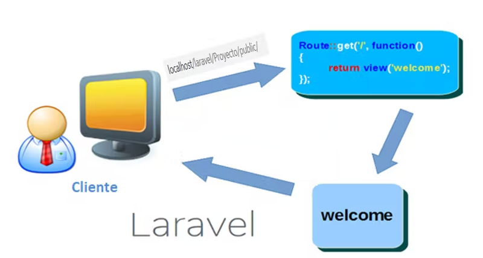

# Rutas

Laravel establece la relación entre el usuario y el servidor mediante rutas.

El sistema de rutas de Laravel es bastante sencillo, por lo que podemos crear rutas de todo tipo y bastante complejas en pocos pasos.

Para crear rutas, Laravel dispone de un archivo específico llamado web.php en la carpeta routes.

Veremos las rutas generales; aun así, encontrarás toda la documentación en el siguiente enlace: <https://laravel.com/framework/docs/13.x/routing>

## Métodos

La aplicación Laravel debe saber interpretar la información que recibe y utilizarla adecuadamente para devolver lo que solicita el cliente. Por tanto, al introducir un URI no solo indicaremos qué debe incluir ese URI, sino también con qué método se llegará a nuestra ruta.

Es fundamental conocer los principales métodos HTTP. Estos son los verbos HTTP que utiliza Laravel:

- Get: Probablemente sea el tipo de ruta más utilizado. Se usa cuando no se envían variables o cuando se envían mediante el método get.
- Post: Envía los datos presentes en la página. Estos datos no se verán en la solicitud, porque viajan en la información del protocolo.
- Put / Patch: Normalmente se utiliza put cuando queremos cambiar datos, por ejemplo, para hacer una actualización.
- Delete: Este tipo de ruta se utiliza para eliminar algo.

Escribiremos todas nuestras rutas en route/web.php; allí estarán las rutas que utilizan la interfaz web.

Al instalar Laravel, la primera ruta que encontramos es la siguiente:


```php
Route::get('/', function () {

return view('welcome');

});
```

Esta será la ruta general; en este caso, la ruta que mostrará la vista welcome.



Este es el ciclo de consulta.

## Enrutamiento básico (Enrutamiento básico)

Todas las rutas de Laravel tendrán como base el directorio raíz. Por tanto, para acceder a la ruta anterior en nuestro servidor local, escribiríamos algo como esto en el navegador:

<http://localhost/LARAVEL_PROIEKTUAK/eskola/public/>

Otros ejemplos de rutas básicas son:

```php
Route::get('/froga/bidea', function () {

return 'GET metodoa';

});

Route::post('/froga/bidea', function () {

return 'POST metodoa';

});

Route::put('/froga/bidea', function () {

return 'PUT metodoa';

});

Route::delete('/froga/bidea', function () {

return 'DELETE metodoa';

});
```


## Varias rutas

Imaginemos que tenemos un sitio web con tres páginas, algo así:

1. http://monsite.fr/ 1

2. http://monsite.fr/ 2

3. http://monsite.fr/ 3

Para ello tendríamos que crear 3 rutas, una para cada página:

```php
Route::get('1', function () {

return 'Ni 1. orria naiz!';

});

Route::get('2', function () {

return 'Ni 2. orria naiz!';

});

Route::get('3', function () {

return 'Ni 3. orria naiz!';

});
```

Como vemos, estas rutas no muestran una vista; cada una solo mostrará una frase.

Para acceder a la primera página, si no tuviéramos dominio, sería algo así:

<http://localhost/proiekto/public/1>

Pero, visto esto, ¿de verdad tenemos que crear 3 rutas cuando lo único que cambia es el valor?

## Rutas con parámetros

Decimos que una ruta está parametrizada cuando puede tomar cualquier valor.

```php
Route::get('{n}', function($n) {

return 'Nire orriaren zenbakia: ' . $n . ' !';

});
```


Es posible que este valor sea opcional; en ese caso debe llevar un signo de interrogación:

```php
Route::get('{n?}', function($n = 1) {

return 'Nire orriaren zenbakia: ' . $n . ' !';

});
```

Como se puede ver en el ejemplo, también hemos asignado un valor predeterminado; es decir, si no se proporciona un parámetro, n tomará el valor 1.

## Errores durante la ejecución y restricciones de rutas

En los ejemplos anteriores, si escribiéramos algo como esto, obtendríamos un error 404:

localhost/laravel/Proyecto/public/4


En cambio, en el caso en que hemos establecido un valor predeterminado, no daría error.

Por otro lado, podemos comprobar que, tal como lo hemos definido, se puede introducir cualquier valor como parámetro; 'n' puede tomar cualquier valor si ponemos lo siguiente:

localhost/laravel/Proyecto/public/edozein gauza

Este sería el resultado:

¡Edozein gauza orria naiz!

## Rutas con nombre

Laravel nos recomienda asignar siempre nombres a nuestras rutas; así será más fácil invocarlas. En el siguiente ejemplo, bastaría con escribir 'home' para invocar esa ruta.

La sintaxis sería la siguiente:

```php
Route::get('/', function() {

return 'Hasiera orria naiz!';

})->name('home');
```

## Orden de las rutas

Es muy importante saber cuál es el orden de las rutas para que se muestre lo que queremos al ejecutarlas.

La regla es la siguiente: las rutas se analizan en el orden en que aparecen en el archivo de rutas.

Por ejemplo, en el siguiente caso:
```php
Route::get('{n}', function($n) {

return 'Nire orriaren zenbakia: ' . $n . ' !';

});

Route::get('contact', function() {

return "Hau nire kontaktua da";

});
```
En la primera ruta, 'n' puede tomar cualquier valor, así que también puede tomar la palabra 'contact'. Por tanto, si escribimos localhost/laravel/Proyecto/public/contact, el resultado será "Nire orriaren zenbakia: contact " en lugar de "Hau nire kontaktua da".

Por tanto, para que ambas rutas funcionen correctamente, primero deberíamos poner la ruta 'contact' y después la otra.

## Grupos de rutas en un controlador

Desde Laravel 9, puedes utilizar el método controller() para agrupar todas las rutas de un controlador. Así el código queda más ordenado.

Por ejemplo, para agrupar todas las rutas que se ejecutarán en el controlador CursoController, utilizaríamos el método group como en el siguiente ejemplo:

```php
Route::controller(CursoController::class)->group(function () {

Route::get('cursos', 'index' );

Route::get('cursos/create',  'create');

Route::get('cursos/{curso}', 'show');

});
```

## Rutas de recurso

En Laravel, cuando creamos nuestros controladores con el método resource, vimos que se generaban varios métodos para poder hacer el CRUD mediante ese controlador. Pues bien, para invocar todos los métodos de ese controlador se puede utilizar una sola ruta; ese método es resource:

```php
Route::resource('ikasleak', IkasleController::class)->names('ikasleak');
```

Como vemos, esto facilita mucho la gestión de nuestras rutas, porque Laravel crea todas las rutas necesarias. Para comprobarlo, podemos consultar con Artisan todas las rutas que hemos creado:

```bash
php artisan route:list
```

Laravel tiene varias convenciones para escribir los nombres al crear rutas. No son obligatorias, pero sí muy recomendables. Sin embargo, si las creamos con resource, los métodos del controlador sí deben seguir esas convenciones: create, store, destroy, etc.
