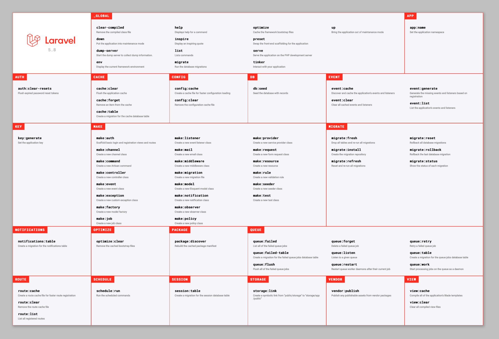

# Artisan

Artisan es una interfaz de línea de comandos que te facilitará enormemente el trabajo con Laravel.

Mediante el terminal, podrás ejecutar unos sencillos comandos para gestionar varios aspectos de tu aplicación web.

Aquí tienes algunos ejemplos sencillos para que entiendas mejor las opciones que ofrece Artisan:

Con los comandos de tipo make podemos crear automáticamente muchas entidades o utilidades sin tener que escribir código. Podemos crear modelos, controladores, vistas, migraciones, middleware, notificaciones…

Además, con Artisan puedes limpiar la caché del proyecto, iniciar un localhost o instalar un sistema de autenticación.

Documentación oficial de Artisan:

<https://laravel.com/framework/docs/13.x/artisan>

Otro aspecto importante de Laravel es Artisan CLI, o línea de comandos. Con ella puedes crear o modificar cualquier parte de Laravel desde la línea de comandos, sin tener que navegar por carpetas y archivos.

Con Artisan puedes interactuar directamente con tu base de datos desde la línea de comandos usando Laravel Tinker, sin instalar un cliente de base de datos.

Por ejemplo, para ver todos los comandos que tiene Artisan, puedes usar list:

```bash
php artisan list
```



Para comprobar si Artisan está instalado:

```bash
php artisan
```
