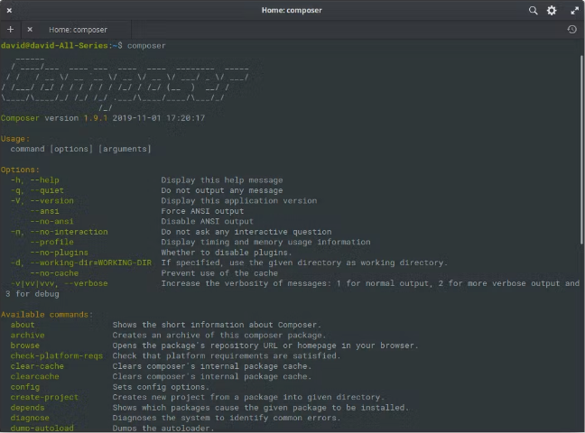

# Composer

Web oficial: <https://getcomposer.org/>

Composer es un gestor de paquetes para PHP, o "gestor de dependencias", y proporciona un estándar para administrar, descargar e instalar bibliotecas y paquetes.

Composer nos ayudará a instalar paquetes y componentes, crear proyectos nuevos, obtener versiones de seguridad, etc.

En lugar de descargar manualmente cada dependencia, Composer lo hace automáticamente.


Antes de instalarlo, comprobaremos si ya está instalado. Para ello, abriremos nuestro terminal y escribiremos lo siguiente:

```bash
composer -V
```

## Instalación de Composer

Si estás en Windows, descarga el instalador de Composer [desde este enlace](https://getcomposer.org/download/).

Para ejecutar Composer, solo tienes que escribir el comando composer en el terminal y pulsar Intro. Encontraríamos algo parecido a lo que se ve en la imagen anterior.

## Comandos y argumentos de Composer



Como puedes ver en la imagen, Composer tiene una lista de comandos y argumentos que nos permiten realizar distintas tareas. A continuación especificaremos y describiremos, uno por uno, los comandos más importantes:

$ composer init

Al ejecutar este comando, se solicitará cierta información que servirá para crear el archivo composer.json.

$ composer install

Este comando procesa el archivo composer.json y resuelve las dependencias; normalmente las instala en un directorio llamado /vendor, pero podemos indicar cualquier otro.

$ composer update

Actualiza las dependencias del proyecto a la última versión y también actualiza el archivo composer.lock. Se puede hacer de varias formas. Imagina que solo quieres actualizar una dependencia concreta; para ello, debes indicar el nombre del paquete así:

$ composer update vendor/package another-vendor/another-package vendor-x/package-x

Esto solo actualizará los paquetes indicados. Si quieres actualizar todos los paquetes de un proveedor concreto, puedes ahorrarte muchos caracteres usando el comodín \*:

$ composer update vendor-x/\*

El comando necesita los paquetes indicados:

$ composer require vendor/package:\*

El comando search busca el paquete indicado en Packagist; solo tienes que pasarle el nombre del paquete.

$ php composer search monolog

El comando show muestra los paquetes disponibles y también permite consultar los detalles de un paquete concreto. Basta con pasarle un argumento, que debe ser el nombre del paquete:

$ php composer show vendor/package

Mostrará información: nombre del paquete, versiones, tipo de paquete, código fuente, archivo zip del código fuente, licencia, etc.

El comando depends indica de qué paquetes depende el paquete especificado. Muestra los paquetes de tipo require y require-dev.

$ php composer depends vendor/package

Para comprobar que nuestro archivo composer.json está escrito correctamente, que nadie tendrá problemas al descargarlo y que no habrá problemas al instalar los paquetes, podemos usar el comando validate.

$ php composer validate

Si haces cambios con frecuencia en tus dependencias y las has instalado desde el código fuente del repositorio, el comando status te permite comprobar si has realizado cambios en alguna de ellas. Funciona igual que git status, que indica qué archivos hemos cambiado:

$ php composer status -v

Si añadimos la opción -v, obtendremos información más detallada sobre los cambios.

## Resultado de ejecutar composer status -v

You have changes in the following dependencies:

vendor/seld/jsonlint:

M README.mdown

El comando self-update actualiza Composer a la versión más reciente; basta con escribir lo siguiente en la consola:

$ php composer self-update

El comando config permite editar varias opciones de Composer, tanto en el archivo local del proyecto como en el archivo global.

$ php composer config --list

El comando create-project crea un proyecto nuevo. Se deben pasar el proveedor y el paquete correspondientes como parámetros. Es lo mismo que descargar el proyecto y luego ejecutar lo indicado en composer.json; el siguiente ejemplo crea un proyecto Laravel.

$ php composer create-project laravel/laravel mi-proyecto

Si ahora necesitas actualizar el archivo autoloader porque tienes clases nuevas, puedes hacerlo con el comando dump-autoload. Es como ejecutar install o update, pero con la ventaja de generar todas las clases del proyecto junto con todos los archivos, así:

$ php composer dump-autoload --optimize

El comando run-script permite ejecutar manualmente uno de los scripts definidos por un paquete.

$ php composer run-script nombre-script --no-dev

Hemos añadido --no-dev para desactivar el modo de desarrollo.

El comando help se usa para consultar información sobre el comando solicitado.

$ php composer help install

El comando remove sirve para eliminar una dependencia que ya no usamos; se utiliza así:

$ php composer remove vendor/package
