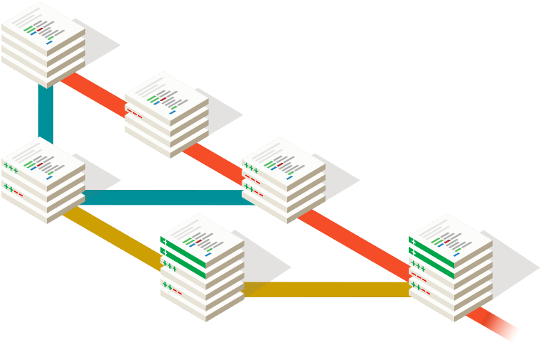

# Git

Web oficial: <https://git-scm.com/>

Git es un sistema de control de versiones. Hasta ahora no era obligatorio instalar Git, pero desde Laravel 11 sí lo es; debemos tener Git instalado.

Al instalar Git también se instalará el terminal Git Bash.

Una vez instalado, nos pedirá configurar un par de cosas: nuestro nombre y correo electrónico:

```bash
git config --global user.name "Jone Martinez"
```

Y el correo electrónico:

```bash
git config --global user.email "jone.m@fptxurdinaga.com"
```


