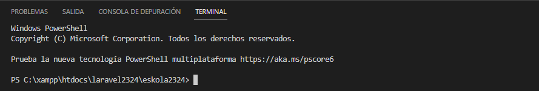

# Git Bash

Como indica Composer, trabaja desde la "línea de comandos", así que para ello podemos usar Git Bash, el terminal de Visual Studio o la consola de Windows.

## Git Bash

- [Cómo instalar Git Bash](https://dev.to/mailingdelgadomedina/como-instalar-gitbash-en-windows-10-4o0e)
- [¿Cómo cambiar la ruta de Git Bash?](https://www.codigonexo.com/blog/programacion/entornos-de-trabajo/cambiar-ruta-de-inicio-git-bash/)

Hay varios comandos para trabajar con Git Bash; puedes encontrar algunos en [este enlace](https://medium.com/@ergalez/comandos-b%C3%A1sicos-en-la-terminal-de-git-bash-en-windows-cbb43c9cea82).

## Terminal de Visual Studio

Puedes acceder desde Ver > Terminal (Ctrl + ñ)

## Consola de Windows

cmd
