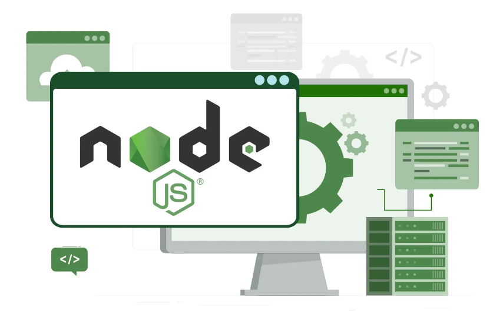

# Node.js

Web oficial: <https://nodejs.org/en/>

En principio, Node.js no sería imprescindible para instalar Laravel, pero incluye varias herramientas que nos resultarán útiles, como Vite y npm.

Al instalar Node.js también se instalará npm.

Para comprobar si está instalado: node -v
