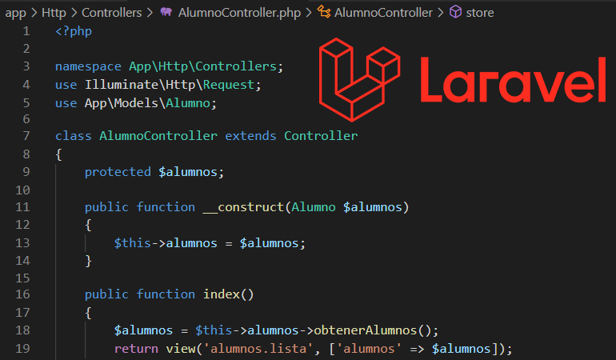

# APUNTES DE LARAVEL 13

En este sitio tendremos el manual de Laravel 13. Aprenderemos qué es Laravel y empezaremos a crear un proyecto paso a paso.

Instalación

Componentes de Laravel

Rutas

Controladores

Vistas

Bases de datos
