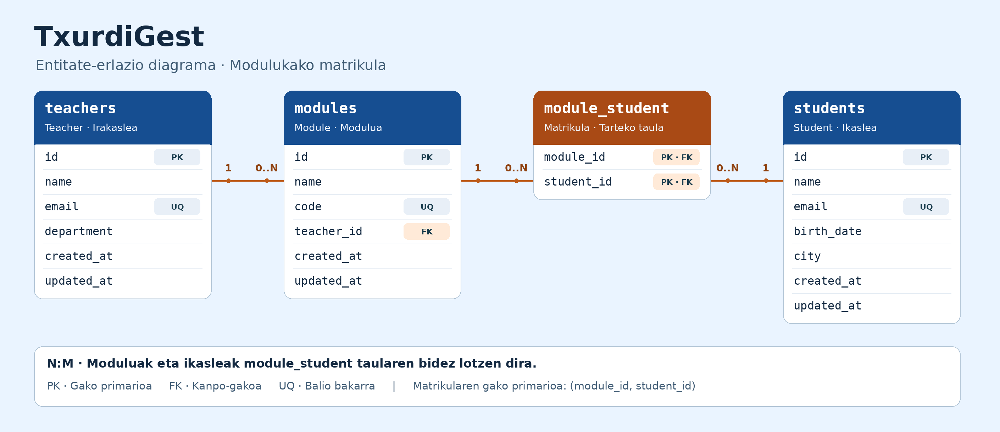

# TxurdiGest · Proiektua sortu

TxurdiGest LHko ikastetxe baten kudeaketa-aplikazioa da. Ariketa gidatuan **modulukako matrikula** egingo dugu. Jon ikaslearen fitxan zer modulutan dagoen matrikulatuta ikusiko dugu. Moduluaren fitxan, berriz, irakaslea eta matrikulatutako ikasleak ikusiko ditugu.

| Entitatea | Modeloa | Taula | Hasierako eremuak |
| --- | --- | --- | --- |
| Ikaslea | `Student` | `students` | `id`, `name`, `email`, denbora-markak |
| Irakaslea | `Teacher` | `teachers` | `id`, `name`, `email`, denbora-markak |
| Modulua | `Module` | `modules` | `id`, `name`, `code`, `teacher_id`, denbora-markak |
| Matrikula | — | `module_student` | `module_id`, `student_id` |

Irakasle batek modulu bat baino gehiago izan dezake (1:N). Ikasle batek modulu bat baino gehiago izan dezake eta modulu batek ikasle bat baino gehiago (N:M). Ariketan matrikulak ikasturte bakarrekoak dira. Gelan datu asmatuak erabiliko ditugu.



## Laravel 13 instalatu

Ireki terminala proiektua gorde nahi duzun karpetan. Egiaztatu terminalak PHP 8.3 edo berriagoa eta Composer aurkitzen dituela.

```bash
composer create-project laravel/laravel txurdigest "^13.0"
cd txurdigest
php artisan serve
```

Ireki nabigatzailean `http://127.0.0.1:8000` aplikazioa ikusteko.

Laravel instalatzailea erabiltzen baduzu, beste aukera bat da `composer global require laravel/installer` eta gero `laravel new txurdigest` exekutatzea. Aukeratu starter kit gabeko instalazioa eta egiaztatu `php artisan --version` aginduarekin 13.x dela.

> `php artisan serve`-ren ordez `composer run dev` ere erabil daiteke: zerbitzaria, Vite, ilara eta logak batera abiarazten ditu.


<a href="https://laravel.com/framework/docs/13.x/installation" target="_blank">Laravel 13 Installation</a>

## Lehen ibilbidea, kontroladorea eta Blade bista

```bash
php artisan make:controller HomeController
```

`routes/web.php`

```php
<?php

use App\Http\Controllers\HomeController;
use Illuminate\Support\Facades\Route;

Route::get('/', [HomeController::class, 'index'])->name('home');
```

`app/Http/Controllers/HomeController.php`

```php
<?php

namespace App\Http\Controllers;

use Illuminate\View\View;

class HomeController extends Controller
{
    public function index(): View
    {
        return view('home.index');
    }
}
```

Sortu karpetak eta fitxategiak ondoko bideetan.

`resources/views/layouts/app.blade.php`

```blade
<!doctype html>
<html lang="eu">
<head>
    <meta charset="utf-8">
    <meta name="viewport" content="width=device-width, initial-scale=1">
    <title>@yield('title', 'TxurdiGest') · TxurdiGest</title>
    <link rel="stylesheet" href="{{ asset('css/app.css') }}">
</head>
<body>
    <header>
        <nav aria-label="Nabigazio nagusia">
            <a href="{{ route('home') }}">TxurdiGest</a>
            <!-- Hemen nabigazio menua jarriko dugu -->
        </nav>
    </header>

    <main>
        @yield('content')
    </main>

    <footer>FP Txurdinaga</footer>
</body>
</html>
```

`resources/views/home/index.blade.php`

```blade
@extends('layouts.app')

@section('title', 'Hasiera')

@section('content')
    <h1>TxurdiGest</h1>
    <p>Kudeatu ikasleak, irakasleak, moduluak eta matrikulak.</p>
@endsection
```

`public/css/app.css`

```css
body {
    max-width: 65rem;
    margin: auto;
    padding: 1rem;
    font: 1rem/1.6 system-ui, sans-serif;
    color: #172533;
}

nav, .pagination {
    display: flex;
    flex-wrap: wrap;
    gap: 1rem;
}

main { margin-block: 2rem; }
footer { border-top: 1px solid #cbd5e1; padding-top: 1rem; }
label { display: block; margin-top: .75rem; }
input, select, button { font: inherit; }
button { margin-top: .75rem; }
.error { color: #a31324; }
```

Azaleko testua agertzen bada eta `php artisan route:list` aginduak `home` ibilbidea erakusten badu, datu-basearekin has gaitezke.

[Hurrengoa · Datu-basea](datu-basea.md)
