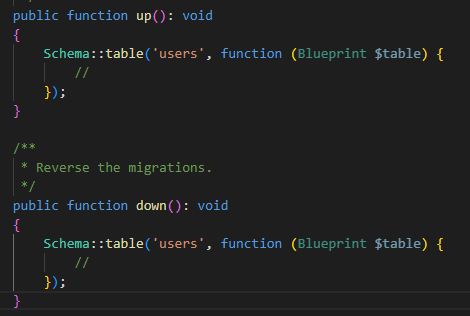

# Migrazioak

## Zer dira migrazioak? 

Migrazioak Laravel-ek datu-basearen bertsio-kontrola eramateko erabiltzen duen sistema dira. 

Horri esker, datu-basean egindako aldaketak dokumentatuta eta kontrolatuta geratzen dira, beste pertsonek ere exekutatu ahal izateko edo arazoren bat egonez gero, aurreko egoerara itzultzeko aukera izateko.

Migrazioak datu basean ditugun taulak kudeatzeko ere erabili ditzakegu, hau da, taula berriak sortzeko, taularen eremuren bat aldatu ahal izateko edota ezabatu ahal izateko.

Migrazioak ```database>migrations``` karpetan gordeko dira. 

### up() - down() metodoak

Migrazio bakoitzak php baten egongo da, eta horretan ikusi dezakegunez Migration klase bat dago 2 metodo dituenak: ```up() eta down()```. Migrazioa exekutatzerakoan ```up()``` metodoari deituko dio, eta reset edo refresh edo horrelakoetan, ```down()``` metodoari deituko zaio.

- **up()**: datu-basean aldaketak aplikatzeko erabiltzen da (taula bat sortu, zutabe bat gehitu...).
- **down()**: up() metodoak egindako aldaketak desegiteko erabiltzen da.


Migrazioekin lan egiteko, artisanek baditu hainbat metodo: ```make:migration, migrate:refresh, migrate:reset eta migrate:rollback```

## make:migration

Migrazio berri bat sortzeko erabiltzen da.

```bash
    php artisan make:migration create_pupils_table

    php artisan migrate
```

- ```make:migration:``` migrazioaren PHP fitxategia sortzen du, baina ez du datu-basea aldatzen.
- ```migrate:``` oraindik exekutatu gabe dauden migrazioak exekutatzen ditu eta datu-basean aldaketak aplikatzen ditu.

Sortuta dauden migrazio guztiak exekutatzen ditu. Migrazio hauek sortze dataren arabera exekutatuko dira, hau da, lehenengo sortutakoa izango da lehena exekutatuko dena.

!!! note
    Laravel-ek bakarrik exekutatu gabe dauden migrazioak exekutatzen ditu beti, automatikoki. Ez du berriro exekutatuko jada exekutatu direnak (migrations taulan apuntatuta daudelako).

```bash
php artisan migrate
```
## migrate:rollback

Azken batch edo "lote"-an exekutatu diren migrazioak desegiten ditu.

Hau da, azken exekuzioan egin ziren migrazio guztiak atzera botatzen ditu (down() exekutatuz).

Batch-a migrations taulako batch eremuan ikus daiteke.

```bash
php artisan migrate:rollback
```

## migrate:reset

Migrazio denak desegiten ditu (down() deituz), ez bakarrik azken lotea.

```bash
php artisan migrate:reset
```

## migrate:refresh

Lehenik reset egingo du (down() metodo guztiak), eta ondoren berriro exekutatuko ditu migrazio guztiak (up() metodo guztiak). Hau oso erabilgarria da garapenean datu-basea "garbi" izateko.

```bash
php artisan migrate:refresh
```

## migrate:fresh

Taula guztiak ezabatzen ditu FIZIKOKI, eta gero up() metodo guztiak exekutatzen ditu.

Ez du down() metodoa erabiltzen, eta horregatik arriskutsuagoa da.

!!! Warning
    ```migrate:fresh```-ek datu-baseko taula guztiak ezabatzen ditu, ez bakarrik migrazioek sortutakoak. Beraz, datu basean ditugun datuak galdu daitezke.

## migrate:status

Komando honek **migrazio bakoitzaren egoera kontsultatzeko** balio du, hau da, migrazioak dagoeneko exekutatu diren ala oraindik exekutatzeko dauden ikusteko.

```bash
php artisan migrate:status
```

Exekutatzean, Laravel-ek migrazio guztien zerrenda erakutsiko digu, bakoitzaren egoerarekin:

- **Ran**: migrazioa dagoeneko exekutatu da, eta `migrations` taulan erregistratuta dago.
- **Pending**: migrazioa sortuta dago, baina oraindik ez da exekutatu.

Gainera, exekutatutako migrazioen **batch** edo lote-zenbakia ere ikus dezakegu. Zenbaki horrek migrazioa zein exekuzio-lotetan aplikatu zen adierazten du.

!!! tip
    Komando hau oso erabilgarria da migrazio berri bat sortu ondoren, `php artisan migrate` exekutatu dugun ala ez egiaztatzeko.

    Kontuan izan `migrate:status` komandoak **ez duela datu-basean aldaketarik egiten**; migrazioen egoerari buruzko informazioa soilik erakusten du.


### Migrazioen komandoen laburpena

Laravel-ek Artisan komandoak eskaintzen ditu migrazioak sortzeko, exekutatzeko eta desegiteko.

Hurrengo taulan komando nagusiak eta bakoitzaren funtzioa laburbiltzen dira:

| Komandoa | Zer egiten du? | Datuak gal daitezke? |
|---|---|---|
| `make:migration` | Migrazio-fitxategi berri bat sortzen du. | Ez |
| `migrate` | Exekutatu gabe dauden migrazioak exekutatzen ditu. | Aldaketaren arabera |
| `migrate:status` | Migrazio bakoitza exekutatuta dagoen ala ez erakusten du. | Ez |
| `migrate:rollback` | Azken lotean (batch) exekutatutako migrazioak desegiten ditu. | Bai |
| `migrate:reset` | Exekutatutako migrazio guztiak desegiten ditu. | Bai |
| `migrate:refresh` | Migrazio guztiak desegin eta berriro exekutatzen ditu. | Bai |
| `migrate:fresh` | Datu-baseko taula guztiak ezabatu eta migrazio guztiak berriro exekutatzen ditu. | Bai |

!!! warning "Kontuz datuekin!"
    `rollback`, `reset`, `refresh` eta `fresh` komandoek datuak ezabatzea eragin dezakete.

    Bereziki, `refresh` eta `fresh` komandoak garapen-inguruneetan erabiltzen dira, datu-basea berriro sortzeko. Ez dira erabili behar datuak mantendu behar baditugu.

!!! tip "Zein da refresh eta fresh arteko desberdintasuna?"
    - **`migrate:refresh`**: migrazioak desegiten ditu `down()` metodoak erabiliz, eta ondoren berriro exekutatzen ditu `up()` metodoak.
    - **`migrate:fresh`**: datu-baseko taula guztiak zuzenean ezabatzen ditu, `down()` metodoak erabili gabe, eta ondoren migrazio guztiak exekutatzen ditu.

    Beraz, `fresh` erabilgarria izan daiteke migrazioetako `down()` metodoak behar bezala definituta ez daudenean ere.


## Taula berri bat sortu migrazio bat erabiliz

Taula berri bat sortzeko, migrazio berri bat sortuko genuke, hurrengo instrukzioa erabiliz:

```bash
php artisan make:migration create_posts_table
```

!!! Note
    Migrazio bat sortzean, komeni da izenak migrazio horrek zer egingo duen adieraztea. Laravel-en, taula berri bat sortzeko, normalean egitura hau erabiltzen da:

    `create_izena_table`

    - **`create`**: taula berri bat sortuko dugula adierazten du.
    - **`posts`**: sortuko dugun taularen izena da. Konbentzioz, minuskulaz eta pluralean idazten da.
    - **`table`**: migrazioak datu-baseko taula bati eragingo diola adierazten du.

    Beraz, `create_posts_table` izenak **posts izeneko taula bat sortuko dugula** adierazten du.

Behin fitxategia sortuta dugunean, klase berri bat sortu digutela ikusi dezakegu, horren ostean up() eta down() metodoak aldatuko ditugu:

```php
    public function up(): void{
        Schema::create('posts', function (Blueprint $table) {
            $table->id();
            $table->string('title');
            $table->text('content');
            $table->timestamps();
        });
    }

    // Reverse the migrations.

    public function down(): void{
        Schema::dropIfExists('posts');
    }
```

## Zelan egin taula baten eremu aldaketa taulak datuak izanda?

Taula baten eremuak aldatzeko, migrazioa sortuko genuke ere. 

Hau horrela egingo genuke datu basean datuak izanez gero, ez izatekotan zuzenean create migrazioa aldatuko genuke eta refresh batekin exekutatu guztiak.

Adibidez, taula baten eremu berri bat sartzeko, migrazio berri bat sortu beharko genuke. Lehen esan dugun moduan, migrazioaren izena edozein izan daiteke, baina "konbentzioz" horrela idatziko genuke:

```bash
php artisan make:migration add_avatar_to_users_table
```



Sortuko zaigu migrazio dokumentu bat aurreko metodoekin, beraz hemen eremua gehituko dugu create kasuan moduan. 

!!! warning 
    Taulan datuak egongo direnez, eremua sortzerakoan jarri behar dugu null izan daitekeela, akatsarik ez emateko, edo balio lehenetsi bat. 
    Hau up() metodoan idatziko dugu.

```php
    public function up(): void
    {
        Schema::table('users', function (Blueprint $table) {
            $table->string('avatar')->nullable();
        });
    }

    public function down(): void
    {
        Schema::table('users', function (Blueprint $table) {
            $table->dropColumn('avatar');
        });
    }
```

Migrazio hau exekutatzerakoan, avatar zutabea gehitu du, baina taularen bukaeran. Horrela nahi ez izatekotan, rollback egingo dugu eta gero aldaketa migrazioan

```bash
php artisan migrate
```

Demagun email eremuaren ostean jarri nahi dugula:

```php
$table->string('avatar')->nullable()->after('email');
```

## Zutabe mota ohikoenak

Migrazioetan, taula bat sortzean edo aldatzean, **zutabe bakoitzean zer motatako datuak gordeko diren** zehaztu behar dugu.

Laravel-ek hainbat metodo eskaintzen ditu zutabeak definitzeko. Hauek dira ohikoenetako batzuk:

| Metodoa | Deskribapena | Adibidea |
|---|---|---|
| `string()` | Testu laburra (lehenespenez, gehienez 255 karaktere). | `$table->string('name');` |
| `text()` | Testu luzea gordetzeko. | `$table->text('description');` |
| `integer()` | Zenbaki osoak gordetzeko. | `$table->integer('age');` |
| `boolean()` | Egia/gezurra motako balioak gordetzeko. | `$table->boolean('active');` |
| `date()` | Datak gordetzeko, ordurik gabe. | `$table->date('birth_date');` |
| `decimal()` | Zenbaki hamartarrak gordetzeko, zehaztasun finkoarekin. | `$table->decimal('price', 8, 2);` |
| `foreignId()` | Beste taula bateko erregistro bati erreferentzia egiteko ID zutabe bat sortzen du. | `$table->foreignId('user_id');` |
| `timestamps()` | `created_at` eta `updated_at` zutabeak sortzen ditu automatikoki. | `$table->timestamps();` |

!!! note "Kontuan izan"
    - `decimal('price', 8, 2)` erabilita, gehienez 8 digitu gordeko dira, horietatik 2 hamartarrak.
    - `foreignId()` erabilita, ID zutabea sortzen da, baina **atzerriko gakoaren murriztapena ez da automatikoki sortzen**. Horretarako, `constrained()` erabil daiteke.
    - `timestamps()` metodoak bi zutabe sortzen ditu, eta gero Eloquent-ek automatikoki kudeatu ditzake.


## Zutabeen propietateak

Zutabe baten datu mota definitzeaz gain, **propietate gehigarriak** ere ezar ditzakegu.

Propietate horiek zutabeak zer balio onartzen dituen edo nola jokatuko duen zehazteko erabiltzen dira.

| Propietatea | Deskribapena |
|---|---|
| `nullable()` | Zutabeak `NULL` balioa onartzea ahalbidetzen du. |
| `default()` | Baliorik zehazten ez denean erabiliko den balio lehenetsia ezartzen du. |
| `unique()` | Zutabean balio errepikatuak egotea eragozten du, datu-baseko murriztapen baten bidez. |

**Adibidea:**

```php
$table->string('email')->unique();
$table->boolean('active')->default(true);
$table->string('avatar')->nullable();
```

- **`email`**: helbide elektronikoa ezin izango da errepikatu.
- **`active`**: baliorik adierazten ez bada, lehenespenez `true` izango da.
- **`avatar`**: erabiltzaileak ez badu irudirik, zutabeak `NULL` balioa izan dezake.

!!! tip
    Zutabe baten definizioan hainbat metodo kateatu ditzakegu:

    ```php
    $table->string('username', 50)->nullable()->unique();
    ```

    Kasu honetan, `username` zutabeak gehienez 50 karaktere izango ditu, `NULL` balioa onartuko du eta `NULL` ez diren balioak ezin izango dira errepikatu.

Dokumentazio ofiziala hurrengo esteka honetan duzue: <https://laravel.com/framework/docs/13.x/migrations>

Hurrengoa: Eloquent
