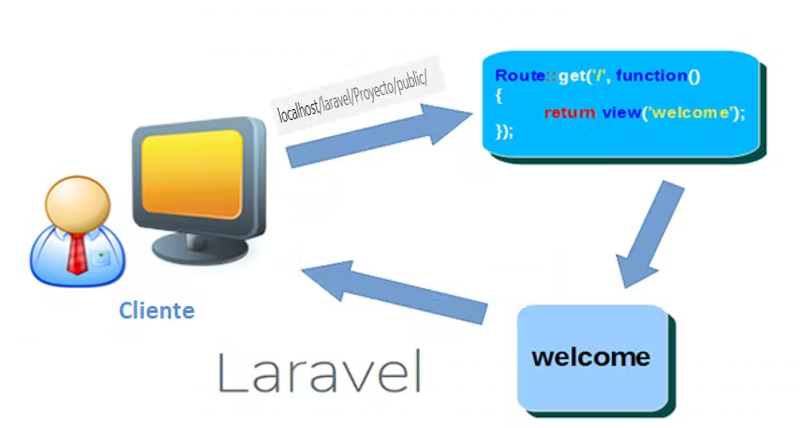
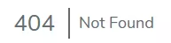

# Rutak

Ibilbide batek (*route*) HTTP eskaera bat ekintza batekin lotzen du. Eskaera bat iristen denean, Laravelek haren HTTP metodoarekin eta URIaren bidearekin bat datorren ibilbidea bilatzen du, eta ibilbide horren ekintza exekutatzen du.

Web-interfazeko ibilbideak `routes/web.php` fitxategian idazten ditugu. Adibideetan `Route` klasea erabiltzeko, ziurtatu fitxategiaren hasieran inportazio hau dagoela:

```php
use Illuminate\Support\Facades\Route;
```

[Laravel 13ren dokumentazio ofiziala · Routing](https://laravel.com/framework/docs/13.x/routing)

## HTTP metodoak

| Metodoa | Zertarako erabili ohi da? |
| --- | --- |
| `GET` | Orrialde bat edo datu batzuk eskuratzeko. |
| `POST` | Datuak bidaltzeko. Adibidez, baliabide berri bat sortzeko. |
| `PUT` | Baliabide baten edukia osorik ordezkatzeko. |
| `PATCH` | Baliabide baten zati bat eguneratzeko. |
| `DELETE` | Baliabide bat ezabatzeko. |

URI bera metodo desberdinekin erabil daiteke. Adibidez, `GET /test` eta `POST /test` ibilbide desberdinak dira.

```php
Route::get('/test', function () {
    return 'GET metodoa';
});

Route::post('/test', function () {
    return 'POST metodoa';
});

Route::put('/test', function () {
    return 'PUT metodoa';
});

Route::patch('/test', function () {
    return 'PATCH metodoa';
});

Route::delete('/test', function () {
    return 'DELETE metodoa';
});
```

Nabigatzailearen helbide-barran URL bat idaztean, nabigatzaileak `GET` eskaera bat egiten du. `POST` probatzeko, adibidez, Blade formulario batean `method="POST"` eta `@csrf` erabil ditzakegu. `PUT`, `PATCH` eta `DELETE` metodoei dagozkien formularioak CRUD atalean ikusiko ditugu.

## Oinarrizko bideratzea

Laravel proiektu berri batean, ohikoa da hasierako ibilbideak `welcome` bista erakustea:

```php
Route::get('/', function () {
    return view('welcome');
});
```

Proba egiteko, ordezkatu aurreko ibilbidea honako honekin:

```php
Route::get('/', function () {
    return 'Welcome!!!';
});
```

`Route::get()`-en lehen argumentua URIaren bidea da. Bigarrena, `GET` eskaera bide horrekin bat datorrenean exekutatuko den ekintza. Adibidean, ekintza funtzio anonimo bat da, eta haren `return`-ak erantzunaren edukia ematen du.




## Ibilbide finkoak

Demagun `/1`, `/2` eta `/3` helbideak sortu nahi ditugula. Helbide bakoitzerako ibilbide bat defini dezakegu:

```php
Route::get('/1', function () {
    return 'Ni 1. orria naiz!';
});

Route::get('/2', function () {
    return 'Ni 2. orria naiz!';
});

Route::get('/3', function () {
    return 'Ni 3. orria naiz!';
});
```

Aldatzen den gauza bakarra orriaren zenbakia bada, hiru ibilbideak parametro bakarreko ibilbide batekin ordezka ditzakegu.

## Ibilbideak parametroekin

### Parametro bat

Giltzen artean idatzitako `{number}` parametroak URLaren segmentu baten balioa jasotzen du. Laravelek balio hori funtzioari pasatzen dio.

```php
Route::get('/{id}', function (string $id) {
    return 'Nire orriaren zenbakia: ' . e($id) . '!';
});
```

`GET /2` eskaeran, `$id` aldagaiak `'2'` balioa hartzen du. `GET /4` eskaera ere ibilbidearekin bat dator. Aurreko hiru ibilbide finkoak soilik definituta bazeuden, berriz, `/4` helbideak 404 emango zuen.


### Bi parametro

```php
Route::get('/posts/{category}/{id}', function (string $category, string $id) {
    return 'Kategoria: ' . e($category) . ', argitalpena: ' . e($id);
});
```

| Eskaera | Emaitza |
| --- | --- |
| `GET /posts/technology/7` | `Kategoria: technology, argitalpena: 7` |
| `GET /posts/music/12` | `Kategoria: music, argitalpena: 12` |
| `GET /posts/music` | 404, baldin eta eskaerarekin bat datorren beste ibilbiderik ez badago. |

`e()` laguntzaileak URLtik jasotako balioa HTMLan testu gisa erakusteko prestatzen du.

### Aukerako parametroa eta balio lehenetsia

Parametroa aukerakoa izan dadin, idatzi `?` izenaren ondoren eta eman balio lehenetsi bat funtzioaren argumentuari.

```php
Route::get('/welcome/{name?}', function (string $name = 'gonbidatua') {
    return 'Kaixo, ' . e($name);
});
```

| Eskaera | Erantzuna |
| --- | --- |
| `GET /welcome` | `Kaixo, gonbidatua` |
| `GET /welcome/Jon` | `Kaixo, Jon` |

Balio lehenetsia segmentua falta denean erabiltzen da. Aurreko `/{id}` ibilbide orokorra ere probatzen ari bazara, jarri `/welcome/{name?}` haren aurretik, `/welcome` helbidea bi ibilbideekin bat baitator.

## Ibilbideen ordena

HTTP metodo eta bide berarekin bi ibilbide bat etor daitezkeenean, jarri **ibilbide zehatzena lehenengo**. Adibide honetan, `/contact` helbidea ibilbide finkoarekin eta `/{number}` ibilbide dinamikoarekin bat dator.

Ordena ikusteko, kendu aurreko `/{id}` definizioa eta erabili bloke hau:

```php
Route::get('/contact', function () {
    return 'Contact page';
});

Route::get('/{id}', function (string $id) {
    return 'Nire orriaren zenbakia: ' . e($id) . '!';
});
```

- Ordena horretan, `GET /contact` eskaerak `Contact page` erakusten du.
- Bi ibilbideak lekuz aldatuz gero, lehenengoak `contact` hartzen du parametro gisa eta `Nire orriaren zenbakia: contact!` erakusten du.
- `GET /7` eskaerak ibilbide dinamikoa erabiltzen du bi ordenetan.

## Parametroen murrizketak

`{id}` parametroaren izenak ez du haren edukia zenbakietara mugatzen. Horretarako, murrizketa bat gehitu behar diogu ibilbideari.

### Adierazpen erregularra `where()` bidez

```php
Route::get('/users/{id}', function (string $id) {
    return 'Erabiltzailea: ' . $id;
})->where('id', '[0-9]+');
```

`[0-9]+` adierazpenak digitu bat edo gehiago onartzen ditu.

### Murrizketetarako laguntzaileak

Aurreko `/users/{id}` definizioa ordezkatu dezakegu `whereNumber()` erabiliz:

```php
Route::get('/users/{id}', function (string $id) {
    return 'Erabiltzailea: ' . $id;
})->whereNumber('id');
```

`GET /users/7` eskaerak `Erabiltzailea: 7` erakutsiko du. `GET /users/alex` eskaerak, berriz, 404 emango du beste ibilbiderik ez badator bat. `/users/999` bideak baldintza betetzen du, digituak dituelako. Erabiltzailea benetan existitzen den egiaztatzea aplikazioaren egitekoa da.

| Laguntzailea | Onartzen duen balioa |
| --- | --- |
| `whereNumber('id')` | Digituak. |
| `whereAlpha('category')` | `a–z` edo `A–Z` letrak. |
| `whereAlphaNumeric('code')` | Letra eta digitu alfanumerikoak (`a–z`, `A–Z`, `0–9`). |
| `whereIn('category', ['music', 'technology'])` | Zerrendan agertzen diren balioak. |




## Izena duten ibilbideak

`name()` metodoaren bidez izena eman diezaiokegu ibilbide bati. Ondoren, `route()` laguntzaileak haren URLa sortzen du. Hasierako ibilbidearen adibidea probatzeko, gehitu `->name('home')` lehendik dagoen definizioari:

```php
Route::get('/', function () {
    return 'Hasiera orria naiz!';
})->name('home');
```

Blade bista batean:

```blade
<a href="{{ route('home') }}">Hasiera</a>
```

Ibilbideak parametro bat badu, haren balioa bigarren argumentuan eman dezakegu. Adibidez, `/users/{id}` ibilbideari `->name('users.show')` gehituz gero, `route('users.show', ['id' => 7])` deialdiak `/users/7` bideari dagokion URLa sortzen du.

## Ibilbide-taldeak kontrolatzailearekin

Hainbat ibilbidek kontrolatzaile bera erabiltzen badute, `Route::controller()` eta `group()` erabil ditzakegu kontrolatzailearen izena behin bakarrik idazteko. Adibide honek `CourseController` eta bertan definitutako `index`, `create` eta `show` metodoak behar ditu.

```php
use App\Http\Controllers\CourseController;

Route::controller(CourseController::class)->group(function () {
    Route::get('/courses', 'index');
    Route::get('/courses/create', 'create');
    Route::get('/courses/{course}', 'show');
});
```

`/courses/create` ibilbide finkoa `/courses/{course}` dinamikoaren aurretik doa.

## Resource ibilbideak

`php artisan make:controller StudentController --resource` komandoak CRUD ekintzetarako metodoak dituen kontrolatzaile bat sortzen du. `Route::resource()` metodoak, berriz, ekintza horiei dagozkien ibilbideak erregistratzen ditu.

```php
use App\Http\Controllers\StudentController;

Route::resource('students', StudentController::class);
```

| HTTP metodoa | Bidea | Kontrolatzailearen metodoa | Ibilbidearen izena |
| --- | --- | --- | --- |
| `GET` | `/students` | `index` | `students.index` |
| `GET` | `/students/create` | `create` | `students.create` |
| `POST` | `/students` | `store` | `students.store` |
| `GET` | `/students/{student}` | `show` | `students.show` |
| `GET` | `/students/{student}/edit` | `edit` | `students.edit` |
| `PUT` / `PATCH` | `/students/{student}` | `update` | `students.update` |
| `DELETE` | `/students/{student}` | `destroy` | `students.destroy` |

Zerrenda eta xehetasun-orria soilik behar baditugu, ordezkatu aurreko deklarazioa honekin:

```php
Route::resource('students', StudentController::class)->only(['index', 'show']);
```

`/students/featured` bezalako ibilbide gehigarri bat definituz gero, jarri `Route::resource()` deklarazioaren aurretik. Horrela, sortutako `/students/{student}` ibilbideak ez du `featured` parametro gisa hartuko.

## Ibilbideak egiaztatzea

Proiektuaren erroko direktorioan, komando hauek exekuta ditzakegu:

```bash
php artisan route:list
```

Begiratu metodoa, URIa, izena eta ekintza. Ibilbide bat probatzean espero duzun erantzuna jasotzen ez baduzu, egiaztatu eskaeraren metodoa, parametroen murrizketak eta bidearekin bat etor daitezkeen ibilbideen ordena.
