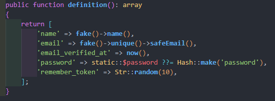

# FACTORIES

Dokumentazioa: <https://laravel.com/docs/12.x/eloquent-factories>

Seederrak aukera onak dira oso datu gutxi ditugunerako, baina badugu beste aukera bat, frogetarako datu asko behar ditugunerako, horretarako Factoriak ditugu, garapenerako pentsatutako klase batzuk dira hauek. Laravel 11-ak UserFactory izeneko factory-a sortuta du jada.

Factoriak nahiko errezak dira erabiltzeko, hurrengo pausuak jarraitu behar dira:

1. PostFactory deitutako klase bat sortuko dugu:

php artisan make:factory PostFactory

2. Ikusten dugunez, database > factories karpetan fitxategi bat sortu du PostFactory.php
3. Definition funtzio barruan, taulako eremu bakoitzeko balio aleatorio bat emango diogu, hau Faker konponentari ezker egin dezakegu.
4. Faker, PHP libreria bat da, datu aleatorioak sortzen dituena, sortu ditzakegu, izenak, helbidek, telefonoan etab...

Faker sortu ahal dituen datu guztiak ikusteko [esteka honetan sartu](https://github.com/fzaninotto/Faker#formatters) edo beste honetan ere <https://fakerphp.org/>

5. Gure adibidearekin jarraituz, guk horrelako erregistro bat sortuko genuke:

6. Baina orain, DatubaseSeeder-en adierazi behar diogu lehenengo Seederra deitu beharrean Factorya exekutatzea. Kodean ikusi daitekenez, adierazi diezaiokugu zenbat biderretan egingo duen, hau da, zenbat datu sortuko dituen, kasu honetan 10 post-en datuak sortuko ditu:

use App\Models\Post;

public function run()    {

$this->call(PostSeeder::class); // Seederrean sortutakoak

Post::factory(10)->create();  // Gure factory-ari 10 biderretan deituko du, beraz, 10 erregistro sortuko ditu.

}

Behin hau eginda, seederra exekutatuko dugu berriro:

php artisan db:seed

Factory formato ezberdinak ikusteko:

<https://github.com/fzaninotto/Faker#formatters>

<https://fakerphp.org/>
