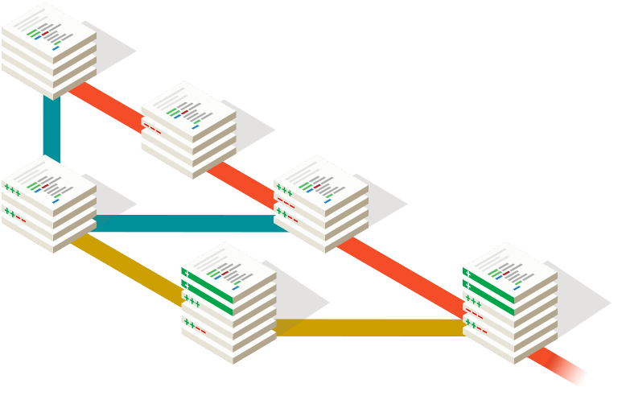

# GIT

Web ofiziala: <https://git-scm.com/>

Git bertsio kontrol sistema bat da, orain arte git instalatzea ez ze derrigorrezkoa baina Laravel 11-n jada bai, git instalatuta izan behar dugu.

Git instalatzerakoan, git bash terminala instalatuko zaigu ere.

Behin instalatuta pare bat gauza konfiguratzeko eskatzen digu, gure izena eta emaila:

git config --global user.name "Jone Martinez"

Eta emaila:

git config --global user.email "jone.m@fptxurdinaga.com"

