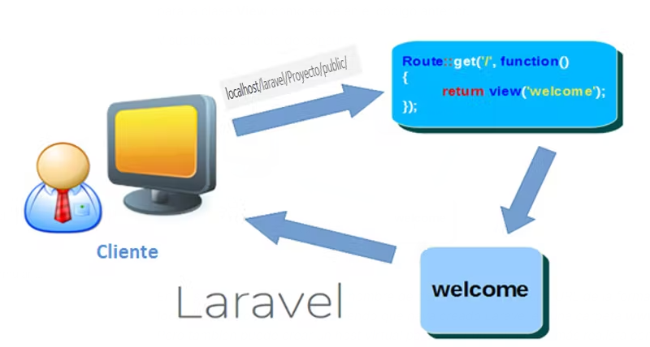
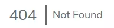

# Rutak

Laravelek erabiltzaile eta zerbitzari arteko erlazioa egiteko ruta edo ibilbideen bidez egiten du.

Laravelen ibilbide-sistema nahiko erraza da, eta, beraz, pausu gutxitan, mota guztietako ibilbide nahiko konplexuak egin ditzakegu.

Rutak sortzeko, Laravelek badu fitxategi zehatz bat routes karpetan web.php izenekoa.

Guk ruta orokorrak ikusiko ditugu, ala ere dokumentazio guztia hurrengo estekan duzue: <https://laravel.com/docs/11.x/routing>

### Metodoak

Sartzen den informazioa interpretatzen jakin behar du Laravel aplikazioak, eta nabarmen erabili bezeroak eskatzen duena itzultzeko. Beraz guk URI bat sartzerakoan ez dugu soilik esango zer den URI-an jarri behar dutena, baizik eta ere zein metodoarekin helduko diren gure rutara.

Funtsezkoa da HTTP metodoaren metodo nagusiak ezagutzea. Hurrengo hauek dira Laravelek erabiltzen dituen HTTP aditzak:

- Get: Seguruenik ruta mota hau da gehien erabiliko dena, hauek aldagiak bidaltzen ez direnean edota get metodoaren bidez bidaltzen dugunean erabiltzen dra.
- Post: orrian bertan dauden datuak bidaliko ditu, datu hauek ez dira eskaeran ikusiko, protokoloaren informazioan bidaiatzen dute eta.
- Put / Patch: Normalean put datuak aldatu nahi dugunean erabiltzen da, update bat egiteko adibidez.
- Delete: zeozer ezabatzeko erabiltzen da ruta mota hau.

Gure ruta edo ibilbide guztiak route/web.php-n idatziko ditugu, hor egongo bai dira interfaz web erabiltzen diren ruta guztiak.

Laravel instalatzean, lehenengo ruta aurkitzen duguna hurrengo hau da:

Route::get('/', function () {

return view('welcome');

});

Hau izango da ruta orokorra da, kasu honetan welcome bista erakutsiko duen ruta.

Hau da kontsulta zikloa

### Oinarrizko bideratzea (Enrutamiento básico)

Laraveleko ruta guztiak, erroko direktorioa izango dute oinarri. Beraz, gure zerbitzari lokalean, aurreko rutara deitzeko, gure nabegatzailean horrelako zeozer idatziko genuke:

<http://localhost/LARAVEL_PROIEKTUAK/eskola/public/>

Beste oinarrizko ruta batzuk ondorengo hauek dira adibidez:

Route::get('/froga/bidea', function () {

return 'GET metodoa';

});

Route::post('/froga/bidea', function () {

return 'POST metodoa';

});

Route::put('/froga/bidea', function () {

return 'PUT metodoa';

});

Route::delete('/froga/bidea', function () {

return 'DELETE metodoa';

});

### Ibilibide anitz

Imagina dezakegun badugula web bat hiru orriekin, hau da, horrelako zeozer:

1. http://monsite.fr/ 1

2. http://monsite.fr/ 2

3. http://monsite.fr/ 3

Horretarako 3 ibilibide sortu beharko genituzke, bat orri bakoitzeko:

Route::get('1', function () {

return 'Ni 1. orria naiz!';

});

Route::get('2', function () {

return 'Ni 2. orria naiz!';

});

Route::get('3', function () {

return 'Ni 3. orria naiz!';

});

Ikusten dugunez, ruta hauek ez dute bista bat erakusten, bakoitzak esaldi bat aterako du soilik.

Lehenengo orri sartzeko, ez bagenuke domeinurik izango, horrelako zeozer izango zen:

<http://localhost/proiekto/public/1>

Baina, hau ikusita, beharko genuke benetan 3 ibilbide sortu, aldaketa bakarra aldatzen den balioa denean?

### Rutak parametroekin

Ibilibide edo ruta bat parametrizada dagoela esaten dugu, edozein balio hartu dezakeenean.

Route::get('{n}', function($n) {

return 'Nire orriaren zenbakia: ' . $n . ' !';

});

Izan daiteke balio hau aukerakoa izatea, kasu horretan, galdera ikurra izan beharko du:

Route::get('{n?}', function($n = 1) {

return 'Nire orriaren zenbakia: ' . $n . ' !';

});

Adibidean ikusi daitekeenez, kasu honetan ere, lehenetistako balioa jarri dugu, hau da, parametrorik ez izanez gero, n-k 1 balioa hartuko du.

### Exekuzio denboran emandako akatsak eta ibilibideen errestrikzioak

Aurreko adibideetan, horrelako zeozer jartzerakoan 404 errorea emango liguke:

localhost/laravel/Proyecto/public/4

Baina aldiz, lehenetsiko balioa jarri dugun horretan ez luke errorea emango.

Bestetik frogatu dezakegu zelan guk jarri dugun moduan, edozein balio sar daitekeen parametro moduan, 'n' horrek, edozein balio har dezake, hurrengo hau jarri ezkero:

localhost/laravel/Proyecto/public/edozein gauza

Hau izango zen emaitza:

¡Edozein gauza orria naiz!

### Izena duten rutak

Laravelek aholkatzen digu gure rutei izenak ematea beti, horrela errezago egingo zaigu hauei deitzea; hurrengo adibidean ruta horreri deitzeko 'home' soilik idatzi beharko genuke.

Sintaxia hurrengo hau izango litzateke:

Route::get('/', function() {

return 'Hasiera orria naiz!';

})->name('home');

### Ibilibideen ordena

Oso garratzitsua da jakitea zein den ibilbideen ordena exekutatzerakoan, guk nahi duguna bistaratu dezan.

Araua hau da: Ibilibideak ruta fitxategian duten ordenean analizatuko dira.

Hurrengo kasuan adibidez:

Route::get('{n}', function($n) {

return 'Nire orriaren zenbakia: ' . $n . ' !';

});

Route::get('contact', function() {

return "Hau nire kontaktua da";

});

Lehenengo rutan, 'n'-k edozein balio har dezakeenez, 'contact' hitza ere hartu dezake, beraz, guk,  localhost/laravel/Proyecto/public/contact jarriz gero, emaitza: "Nire orriaren zenbakia: contact " izango da, "Hau nire kontaktua da" izan beharrean.

Beraz, ruta biak ondo funtzionatu dezaten, lehenengo 'contact' ruta jarri beharko genuke eta ondoren bestea.

### Ibilbide-taldeak kontrolatzailean

Laravel 9-tik aurrera, controller() metodoa erabil dezakezu Kontroladore baten ruta guztiak honen barruan izateko. Horrela eginez gero, kodea txukunago geratuko litzateke.

Adibidez CursoController kontroladorean exekutatuko diren ruta guztiak elkarrekin batzeko, group metodoa erabiliko genuke hurrengo adibidean moduan

Route::controller(CursoController::class)->group(function () {

Route::get('cursos', 'index' );

Route::get('cursos/create',  'create');

Route::get('cursos/{curso}', 'show');

});

### Resource ibilbideak

Laravelen ere, gure kontroladoreak resource metodoarekin egiterakoan, ikusi genuen zelan sortu zizkigun hainbat metodo kontroladore horren bidez CRUDa egin ahal izateko, ba kontroladore horren barruan dauden metodo guzti horiek deitzeko ibilibide bakar bategaz egin dezake, metodo hori resource metodoa da:

Route::resource('ikasleak', IkasleController::class)->names('ikasleak');

Ikusten dugunez, honek asko errazten digu gure ibilibideen kudeaketa, Laravelek sortzen bait ditu beharrezko ruta guztiak. Hau konprobatzeko, artisanen bidez begiratu dezakegu sortuta ditugun ruta guztiak:

php artisan route:list

Laravelek baditu hainbat konbentzio rutak sortzerako momentuan, izenak modu zehatz baten idazteko, hauek ez dira derrigorrezkoak, baina bai oso gomendagarriak. Baina resource-ren bidez sortuz gero, kontroladorearen metodoek bai jarraitu behar dituztela konbentzio horiek: create, store, destroy etab...
