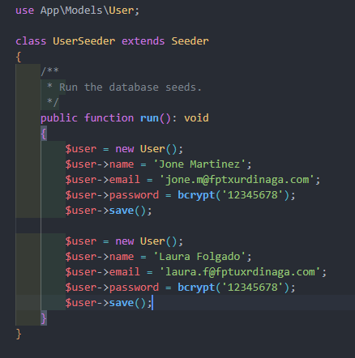
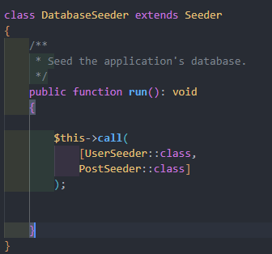

# SEEDER

Seeder Laraveleko konponente batzuk dira datu basean datuak sartu ahal izateko. Hauek normalean garapen prozesuan datuak sartzeko edo aplikazioren hasieran behar diren datuak sartzeko balio dute.

Zelan egingo genuke hau?

Gure direktorioan egonda, artisaneko sententzia hau idatziko genuke IkasleSeeder sortzeko:

php artisan make:seeder UserSeeder

database > seeders-en sortuko du fitxategia.

Fitxategian, gure modeloa zein den adieraziko diogu, horretarako Ikasle klasearen erreferentzia sortuko dugu:

use App\Models\User;

$user aldagaia sortu eta bere propietate guztiak beteko ditugu irudian agertzen den moduan, ikusten duzuenez gure datu baseko taulak objeto moduan erabiliko ditugu.

Artisanek, Seederak exekutatzerakoan, bete DatabaseSeeder klasea deituko du; beraz, guk gure seederra exekutatzeko, klase horretako run() metodotik gure klasea "deituko" (instanciar) dugu.

Bat baino gehiago deitu daiteke metodo honetatik, eskuz idatzitako ordenean exekutatko litzateke.

$this->call(UserSeeder::class);

Behin hori guztia eginda, gure datu basean datuak kargatzeko, seeder-a exekutatuko dugu:

php artisan db:seed

Irudian, bi seeder exekutatuko ditu, horretarako array batean sartuko ditugu biak. Egin genezakeen ere bi biderretan call metodoari deitu, hori bai, beti behar dugun ordenean:

$this->call(UserSeeder::class);

$this->call(PostSeeder::class);

Horrela egitekotan, seederra bakarrik exekutatuko litzateke, baina askotan nahi dugu seederrak migrazioak exekutatzeko momentu berdinean egin, horretarako, hurrengo komandoa exekutatuko genuke:

php artisan migrate:fresh --seed

Kasu honetan egingo duena izango da, taula guztiak ezabatu, berriro sortu eta guk seederrean esandako datuak gorde.

Dokumentazio ofiziala: <https://laravel.com/docs/12.x/seeding>
